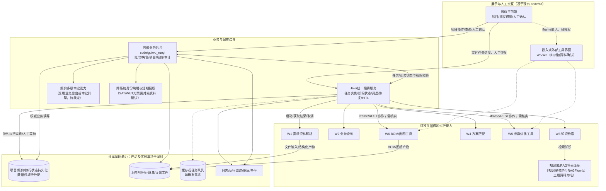
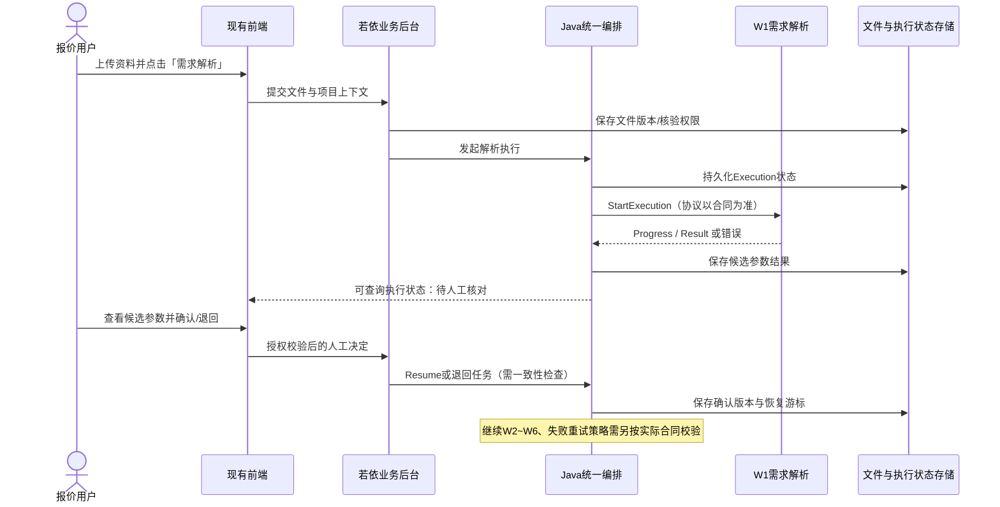
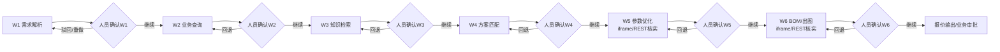
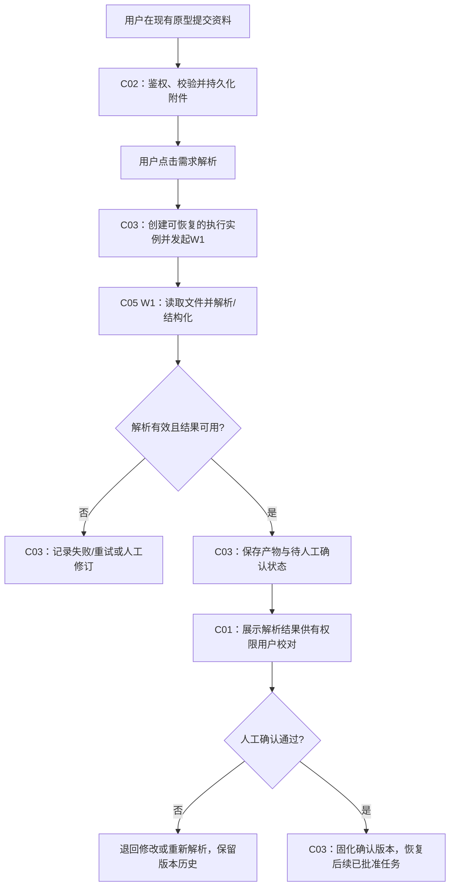
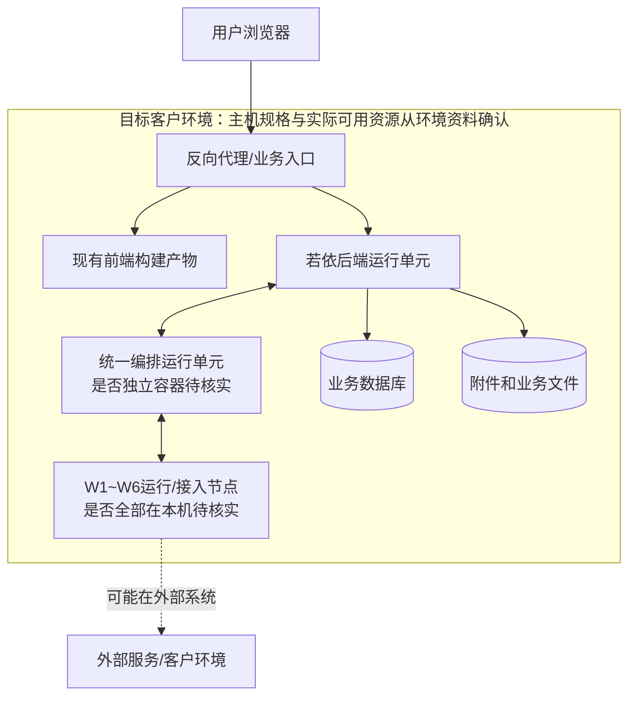

# 报价系统整体架构——组件与交互骨架示例

> **示例，不是已完成的实际报价项目架构设计。** 本仓库没有上传真正的 `docs/input/` 项目PRD、Worker接口合同和实际 `code/` 源码；因此无法对组件是否已部署、具体协议端点、审批引擎或各运行单元资源分配作最终确认。本例根据此前明确讨论过的“统一前端 + 统一编排 + W1~W6 + 知识插件 + 人工确认”等报价业务设想，演示**整体架构设计应该产出多完整的组件与交互骨架**。所有后文标“候选/待核实”的细节必须经真实资料与内置Grill核实，不能直接交付。

# 1. 系统概述

## 1.1 建设背景与系统边界

本示例是报价系统的**架构交互骨架演示**：用户通过现有前端和若依后台处理报价项目，统一编排协调W1~W6及人工确认，涉及业务查询、知识检索、参数优化、BOM/出图、报价审批和归档。实际业务范围应以真实需求基线为准。

**本系统负责（候选）**：报价主流程、统一业务权限、执行状态协调、人工确认、审批记录及结果追溯。**外部系统负责**：各独立Worker自身算法和外部工具界面；是否由客户已有系统提供必须读对接资料确认。

## 1.2 关键指标、目标服务器与选型

| 主题 | 本示例必须引用的真实依据 | 影响的架构决定 |
|---|---|---|
| 技术栈 | docs/output/01-项目基线/项目基线.md和已核实code/工程版本 | 统一前端/后端/编排的运行与通信兼容 |
| 并发与长任务 | 需求基线及项目基线中的在线量、执行并发与任务时限 | 编排排队、Worker资源、超时和取消 |
| CPU/内存/磁盘 | 真实环境资料及项目基线数值预算 | 运行单元合并或分离、外部服务依赖 |
| 数据留存/RPO/RTO | 已确认基线中的具体年限和恢复要求 | 报价/执行状态、附件、索引的持久化与恢复 |

当前仓库不包含客户正式服务器输入，故**不把8核16GiB或其他演示数值写成已审批运行环境**。

## 1.3 外部环境与对接对象

| 对接类别 | 示例对象 | 进入架构必须明确的依据 |
|---|---|---|
| 外部执行能力 | W1~W6，区分原生Worker与iframe/REST | 实际接口协议、部署主体和调用授权 |
| 知识检索 | W3与知识库服务 | 后端产品/连接方式/数据归属及权限 |
| 其他系统和文件 | 资料上传、第三方计算、文件输出和审批能力 | 对接合同、文件来源、真实回执及成功边界 |

# 2. 总体架构设计

## 2.1 全局组件拓扑（逻辑组件与部署服务分离）

**整体目的**：先明确 *有哪些主要组成、由谁执行、如何协作*，再由模块设计继续细化表字段、API参数与代码。

**阅读规则：** 实线表示本示例必须讨论的交互关系；虚线是接入类型或组件独立部署方式尚未核实的候选。图中的“若依业务后台”和“Java编排服务”是**逻辑责任边界**，不表示必须各启动一套服务。图不是已验证的 Docker 部署事实。

## 2.2 全部组件清单与责任边界

| ID | 组件/能力 | 主要责任与拥有的状态 | 与谁交互 | 代码/部署判定 |
|---|---|---|---|---|
| C01 | 报价主前端 | 已有原型页面、项目入口、任务进度、人工确认/审批交互 | C02、C03、C10 | 复用 `code/fld/`；真实框架版本要核实 |
| C02 | 若依业务后台 | 用户/角色/项目权限、核心报价业务、审批动作、业务审计 | C01、C03、C04、C11、C12 | 在 `code/guiwu_ruoyi/` 中扩展 |
| C03 | Java统一编排 | W1~W6的执行顺序、执行实例、结果、超时、取消、人工等待/恢复 | C02、C05~C10、C11 | 是否独立容器以实际方案和资源预算确认 |
| C04 | 审批能力 | 报价多级审批、领取/退回/重提及历史 | C02、C11 | 若采用 Flowable，要核实是否已裁定及其真实集成方式；**不同于Agent编排** |
| C05 | W1 需求资料解析 | 多文档解析、归一化结构化结果 | C03、C12 | 接口/模型参数传递以真实对接合同确认 |
| C06 | W2 业务查询 | 查询真实业务数据、返回必要的结构化结果 | C03、C02 | 查询权限由后端控制 |
| C07 | W3 知识检索 | 知识库查询、关联来源与结果 | C03、C13 | 知识后端RAGFlow是候选/既有约束，需核对 |
| C08 | W4 方案匹配 | 根据确认结果选择业务方案及匹配依据 | C03、C05~C07 | 输入前置依赖要通过Grill核对 |
| C09 | W5 参数优化 | 参数优化服务及人工可交互界面 | C03、C10、C01 | 已讨论 `iframe/REST`，不得擅自写成gRPC |
| C10 | W6 BOM/出图 | BOM构成、图纸或导出产物 | C03、C01、C12 | 已讨论 `iframe/REST`，结果如何回收需核对 |
| C11 | 业务/执行状态存储 | 业务状态、编排状态各自的唯一写入权威 | C02、C03、C04 | 真实表/实例边界留给数据库总体；逻辑Owner此处必须确定 |
| C12 | 文件存储 | 原始需求文件、计算单、导出BOM与图纸 | C02、C05、C10 | 使用现有文件系统还是外部存储依据容量/环境裁定 |
| C13 | 知识服务 | 文档入库、索引、检索调用与权限范围 | C07 | 依据知识库对接资料确认具体产品与部署 |
| C14 | 身份转换/调用安全 | 登录Token、服务令牌、iframe短期凭证及作用域 | C01、C02、C03、C09、C10 | 已讨论SAT/WUT方案，时效与换发规则需真实合同 |
| C15 | 日志、健康和备份 | 跨执行ID追踪、故障定位、DB/附件恢复 | 业务和编排单元 | 与基线的资源和RPO/RTO对齐 |

**重要：** 上表标识的是必须逐一核验的总体组件/能力，不等同15个微服务或15个Docker容器。实际 `docs/input/` 若证实某一能力不存在，删掉对应组件并记录原因；若还有外部系统或设备，则继续补入。

## 2.3 组件关系总表（按发起方→接收方核对）

| 业务关系 | 发起 → 接收 | 操作/协议（已讨论或待核实） | 状态、身份及异常责任 |
|---|---|---|---|
| 组件关系 | 主前端→若依 | 认证后的REST业务操作 | 若依为项目/业务权限裁决者；失败不能被前端标成功 |
| 组件关系 | 前端/若依→统一编排 | 启动业务长任务并获取执行ID；协议以现有方案确认 | 执行实例必须有持久状态，前端离开后仍可查询 |
| 组件关系 | 编排→原生Worker | 已讨论 StartExecution/GetExecutionResult/CancelExecution（gRPC候选） | 请求含执行身份、deadline和幂等键；不能盲目重复执行 |
| 组件关系 | Worker→编排 | 已讨论HTTP进度回调或结果轮询（以合同为准） | 对同一Execution ID关联进度与结果；超时/重复回调防错 |
| 组件关系 | 主前端→W5/W6交互界面 | iframe加载和短期凭证交换；实际业务数据走REST | 不允许浏览器单靠URL获得越权访问权限 |
| 组件关系 | 编排/页面→W5/W6业务能力 | 由iframe/REST集成方式决定任务触发与结果获取 | **不能把iframe本身当成后台RPC**；失联必须保留可恢复状态 |
| 组件关系 | W3→知识库服务 | 权限范围内的检索API，产品和鉴权从对接资料确定 | 知识命中结果不自动成为正式业务确认 |
| 组件关系 | 编排→人工确认/继续 | 按Execution阶段进入等待，确认或驳回后Resume | 人员与权限来自若依；人工动作及上下文不可丢失 |
| 组件关系 | 报价业务→审批能力 | 多级审批、领取、通过/驳回/重新提交 | 与编排HITL是不同的业务状态；审批历史有权威存储 |
| 组件关系 | 系统→文件存储 | 上传、解析、导出、下载/归档 | 文件与业务引用版本一致，存储年限来自基线 |
| 组件关系 | 组件→监控日志 | 任务/请求ID关联，失败、超时、重复操作与资源耗尽监测 | 统一追踪和健康检查，不能只依赖页面成功提示 |

表中的接口名称、消息字段与协议属于**应向实际对接资料校验的要点**。例如 SAT/WUT、gRPC、HTTP Progress Callback 是此前讨论过的方案，不因此宣称代码里已经实现。

## 2.4 关键端到端链路：需求解析与人工确认

注意：**任务已受理、Worker完成、人工确认、报价业务审批通过**属于不同状态，不能合并成一个“成功”。

## 2.5 Worker执行主干与人工确认

图示用于说明要画出每一处交互与人工关卡，本示例依据此前讨论的“每一阶段人工确认”原则逐一标明HITL节点；各确认动作的真实角色、驳回目的地与恢复索引，仍须按已确认需求基线及真实编排合同裁定，不能将示范箭头直接投入生产。

## 2.6 全局身份、数据与状态归属

| 关键问题 | 本设计必须写清 | 不得做的事 |
|---|---|---|
| 用户身份 | 主系统登录Token与iframe/Worker所需的临时授权如何转换 | 随意把用户口令/API Key放进URL |
| 执行状态 | 执行实例、Worker执行进度、持久结果/恢复点由谁保存 | 只把状态放浏览器或一个HTTP请求 |
| 业务状态 | 正式报价版本、人工确认结果、多级审批历史由哪一业务组件裁决 | 让Worker直接绕开主系统更新审批 |
| 编排方式 | Java确定性顺序控制、必要等待/继续/取消及失败策略 | 在未批准前改为另一套Agent编排框架 |
| 部署 | 若依、编排、六Worker、知识服务的实际进程/容器映射和资源 | 将15个逻辑组件无依据地等同15个容器 |
| 持久存储 | MySQL、缓存、附件/知识索引的实际实例位置和恢复 | 画一个MySQL框就假定所有数据持久化完成 |

## 2.7 案例工程落点、适用性与冻结审核（示范，未获客户审批）

本案例沿用已讨论的现有报价前端原型与后端工程，原则上新增业务应在其真实模块中扩展、复用原有布局/权限/API接缝；不得重建第二套UI及认证。但本仓库没有上传实际客户 `code/`，因此**不能声称已核实具体路由、目录、文件或模块结构**。

| 核心业务场景 | 组件主责 | 候选工程落点 | 数据与通信责任 |
| --- | --- | --- | --- |
| 资料上传及需求解析 | C02业务后台、C03统一编排 | 现有报价项目/需求解析页面（实际目录待核实） | 主前端→后端→编排→W1；附件与Execution各自有Owner |
| 多级审批 | C02业务后台、C04审批能力 | 现有报价审批模块（待扫描工程） | 业务后台→审批能力；Worker不能直接修改审批权威 |

| 专项 | 触发证据/结论 | 主要架构责任 |
| --- | --- | --- |
| Web/审批 | 存在页面和报价审批，启用 | 复用公共身份、区分业务审批与AI人工确认 |
| Agent/编排 | 有统一编排、知识服务，启用 | 执行持久状态、权限、HITL和恢复 |
| 第三方/Worker | W1至W6及iframe/REST讨论，启用但接口待核实 | 每个Worker的真实接入协议、回执、授权和部署 |
| IoT | 未见该案例存在设备采集，暂不适用 | 不为公司其他IoT业务强加MQTT或设备组件 |

| 级别 | 示例约束（仅供评审，不是已批准冻结） |
| --- | --- |
| A | 若确认Java编排和报价审批Owner，模块不能擅改编排框架、让Worker越权修改业务终态 |
| B | 原有前端原型风格、后端权限和公共组件必须优先复用 |
| C | 各报价模块API字段、数据库表和内部算法由S09细化 |

本案例的**第二轮开发可执行审核仍然待执行**：开发人员需要真实核查前端路由、业务API封装、后端项目权限及W1接口合同；不能凭案例把“架构已冻结”标记通过。

## 2.8 关键业务链路示例：需求解析与人工确认（仅示范）

上面的W1~W6组件全景图只能说明系统“有什么”。本案例还需解释**资料上传后，解析任务究竟经过哪些步骤、谁保存结果、失败时怎么办、人工确认后如何继续**。以下是**候选架构示意**，需用真实PRD与接口合同审核。

| 业务处理步骤 | 责任组件 | 需要确认的架构约束 |
| --- | --- | --- |
| 资料上传与项目权限 | C02/C12 | 已有API、附件权威来源、版本与权限 |
| 触发解析与等待 | C03 | Execution ID、状态持久化、超时及取消 |
| W1解析与回传 | C05→C03 | W1真实协议、进度/结果、失败重试 |
| 人工校对与放行 | C01→C02→C03 | 人工身份、权限、版本回退与恢复条件 |
| 异常出口 | C03及对应执行组件 | 文件不可读、任务失败、重复回调及恢复 |

核心二的审核不能只停在“C03→W1”。必须沿每个业务处理节点完成**处理步骤→组件→状态Owner→成功/失败**追踪，并反向检查W1等组件在真实关键链路中的用途。本例并不证明已读取真实客户代码、接口或已经获得审批。

# 3. 关键运行参数和值

此处必须从**当前已确认的项目基线和环境资料**填入具体值，不得从其他项目复制一组假数。

| 参数类别 | 当前示例的输入情况 | 应约束的组件 |
|---|---|---|
| CPU/内存/磁盘分项预算 | 需要真实项目基线数值，暂不能宣称已确认 | 若依、Java编排、W1~W6、数据与文件存储 |
| HTTP请求与长任务并发、队列 | 需要真实人数、执行并行度和等待边界 | API、编排状态与Worker |
| gRPC/REST/iframe认证与超时 | 已讨论过SAT/WUT、gRPC执行接口及HTTP进度，但协议须逐Worker核实 | 身份桥接、编排、W1~W6 |
| 数据留存与RPO/RTO | 需要已签署的实际保存期限和恢复目标 | 业务数据库、执行状态、知识索引与附件 |

# 4. 部署、安全与运维设计

## 4.1 部署节点与组件分配（候选拓扑）

只有真实环境资料明确的CPU/内存/磁盘/网络/服务位置才能进入最终部署表；Worker实际在单机还是第三方服务器，不能凭本示例确定。

## 4.2 安全边界

若依是业务权限裁决者；跨Worker身份/短期令牌权限与有效期需明确记录。iframe不能绕过主系统鉴权；第三方回调需要验签或可信网络保证（具体方式依据对接合同）。

## 4.3 可观测性

编排Execution ID、业务项目ID和工作单元运行ID须可关联，记录状态转换、Worker进度与回调、重试和超时。任务被接受与结果已确认必须区分。

## 4.4 备份与恢复

正式架构需根据基线明确业务数据库、执行状态、上传附件、BOM/图纸、必要知识索引是否可恢复及其先后顺序；没有经确认的备份目标或恢复演练，不得写“满足RPO/RTO”。

## 4.5 对后续数据库总体与模块设计的约束

| 后续设计 | 应在本骨架内继续做 | 不得无审批改动 |
|---|---|---|
| 数据库总体 | 数据域、是否分库分表、留存与存储边界 | 统一编排/业务状态/Worker的数据Owner |
| 模块拆分 | 把报价业务能力分模块，确定研发迭代依赖 | 已审定的Worker/运行单元及跨组件通信方式 |
| 当前模块详细设计 | 页面动作、API参数字段、表结构/SQL草案、异常规则 | 顶层组件职责、协议、身份转换/执行状态所有权 |
| 部署/集成 | Docker Compose与连接配置、实际服务健康验收 | 已裁定的资源预算与系统边界 |

# 5. 剩余问题（真实资料未提供前不能批准）

1. 本仓库未提供真实报价PRD、工程资料、服务器资料及Worker接口原文；必须先扫描项目中的完整 `docs/input/`。
2. 尚需核对六个Worker的**实际**调用协议、执行状态接口、回调/幂等机制、哪些部署在客户环境、哪些通过iframe访问；并非所有Worker必然gRPC。
3. 需要明确业务报价审批与Agent流程HITL各自的最终权威组件，以及它们的版本/驳回同步关系。
4. 需要把每个实际部署单元映射到已确认CPU/内存/磁盘预算，并验证同机能否运行，不能无依据声称“8核16G足够”。
5. 所有关键问题在 `architecture-baseline` 内调用 `grill-with-docs` 澄清并取得人员确认后，才能形成最终可审核总体架构。

**这才是“整体架构示例”的应有深度：组件全景、明确责任、所有主要交互、状态与身份、部署骨架和下游不可擅改的边界，而不是只画几条基础设施箭头。**