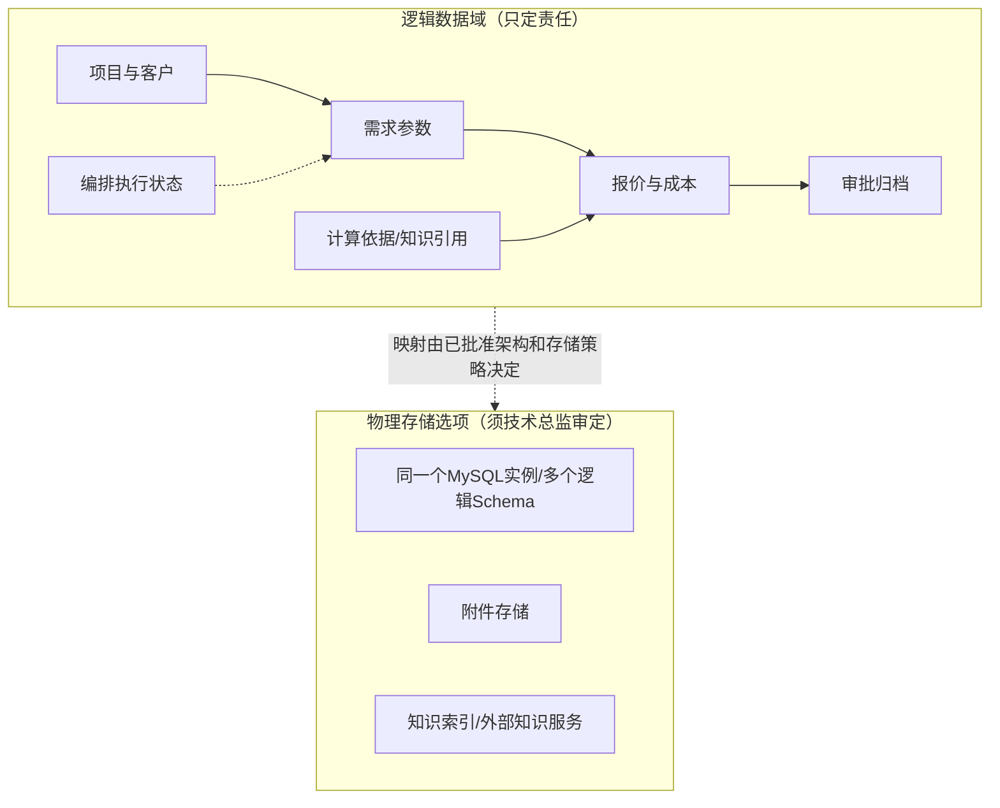
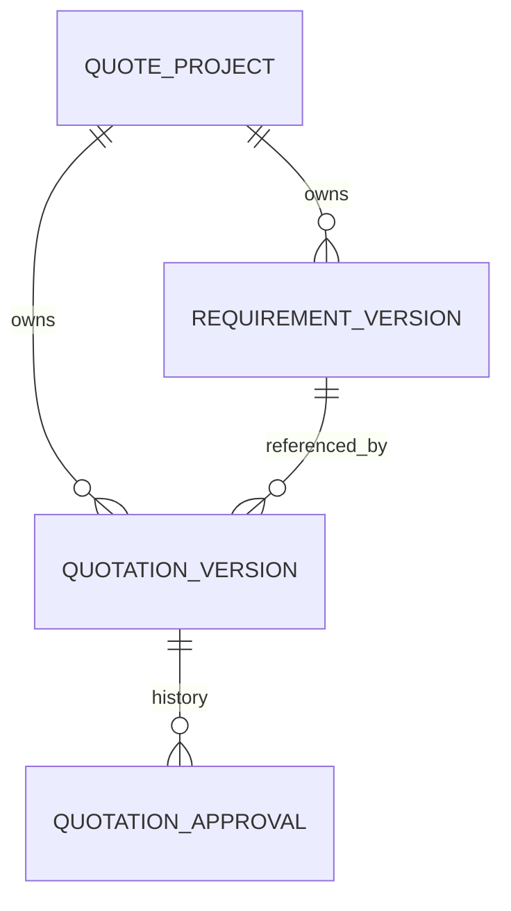

# 报价系统数据库总体骨架示例（候选，不代表已审批）

本阶段在已审定整体架构基础上完成**整体数据规则→关键数据生命周期→核心表/核心字段及关系**，再确定存储与容量。允许定义跨模块不可缺少的关键字段，但不写所有字段/辅助表及DDL。以下仅为候选案例，非真实已审批结构。

## 1. 业务数据域与最终权威

| 数据域 | 主要业务对象 | 在整体组件骨架中的权威归属 | 主要跨域关系 |
|---|---|---|---|
| 项目与客户 | 报价项目、客户、项目生命周期 | 若依业务后台中的项目业务能力 | 给解析任务、报价、审批提供统一项目身份 |
| 需求与参数版本 | 输入资料、解析候选、人工确认参数 | 若依需求业务能力；编排保留任务执行状态 | 已确认版本供匹配和报价引用 |
| 知识与计算依据 | 历史计算单、知识检索来源、匹配结果 | 各自数据Owner须由完整交互骨架确定 | W3知识检索结果不能直接变成正式报价 |
| 报价与成本 | 成本核定、正式报价、输出版本 | 已审定报价业务权威组件 | 引用人工确认参数与计算依据版本 |
| 审批与归档 | 审批状态、人员历史、客户交付物 | 业务审批及归档组件 | 审批不应直接改写执行编排状态 |
| 长任务执行 | Execution、Worker进度、人工暂停/恢复状态 | **统一编排**中已批准的状态Owner | 审批与任务执行状态各自独立、必要时关联 |
| 文件与审计 | 原始上传文件、BOM图纸、导出文件、业务审计 | 文件存储及审计组件，具体物理实例以环境为准 | 文件版本必须与报价引用关系兼容 |

## 2. 数据域不是数据库实例

业务域分成7个，并**不意味着必须有7个数据库**。是否需要多库、分表或独立存储由真实部署与容量、写入/查询模式、合规隔离等证据决定。

## 3. 分库分表的可审查决策（示例表达）

| 决策项 | 对报价系统的候选处理 | 需要确认的事实 | 何时重审 |
|---|---|---|---|
| 独立业务库 | 单机资源有限时优先单MySQL实例，按模块逻辑隔离 | 实际CPU/内存预算、所有权与权限模型 | 安全隔离、独立扩容或业务增长出现真实需求 |
| 业务分库 | **不因W1~W6独立部署就自动分库** | Worker是否拥有独立业务权威、跨库事务成本 | 明确不同业务写入Owner和资源隔离要求 |
| 水平分表 | 无数据量/访问热点证据时不预设分片 | 年增长量、读写峰值、保留年限、索引膨胀 | 单表或实例增长达到已确认容量/性能阈值 |
| 文件/索引独立 | 大文件和知识索引按真实对接要求区分 | 附件年增长、RPO/RTO、知识后端实际位置 | 文件备份/检索需要独立生命周期时 |

**判断关卡**：只输出确定的“采用/暂不采用”及其理由、数值依据和触发条件，不能写“为了未来扩展预留分库分表”却没有可评审边界。模块详细设计才做具体业务表字段、索引、SQL。

## 4. 从报价数据生命周期导出核心结构（候选示例）

关键数据链：项目创建 → 需求解析候选 → 人工确认参数版本 → 匹配/成本计算引用版本 → 报价版本生成 → 审批与归档。

| 全局规则 | 关键数据变化 | 核心表候选 | 核心字段候选（需对真实工程核准） | 关联与约束 |
|---|---|---|---|---|
| 项目统一身份 | 报价项目创建及引用 | `quote_project` | `id`、`project_code` | 业务编码唯一；下游用相同项目ID |
| 已确认参数不可静默覆盖 | 解析结果被人工确认后保留版本 | `requirement_version` | `id`、`project_id`、`version_no`、`confirmed_at` | 项目1:N参数版本，重解析生成可追溯的新版本 |
| 报价锁定计算依据 | 形成可签核的正式版本 | `quotation_version` | `id`、`project_id`、`requirement_version_id`、`quote_version_no`、`status` | 每份报价明确引用参数版本，状态不得被重算悄悄改写 |
| 审批历史可追溯 | 审批通过/驳回/重提 | `quotation_approval` | `id`、`quotation_version_id`、`action`、`handled_at` | 报价版本1:N审批记录，保留历史 |

> 表名、字段名、数据类型、物理外键和是否复用既有表均需要依据真实`code/`及数据库产品在S05正式设计中裁定；以上不是建表DDL或客户已确认结构。

### 必需核心字段类型与关系契约（候选，不等于已核实DDL）

| 核心表 | 必要字段与候选类型 | 非空/唯一/状态口径 | 数据Owner及引用 |
|---|---|---|---|
| `quote_project` | `id BIGINT`、`project_code VARCHAR(64)` | id主键，project_code业务唯一且非空 | 项目管理权威写，其他模块按id引用 |
| `requirement_version` | `id BIGINT`、`project_id BIGINT`、`version_no INT`、`confirmed_at DATETIME(3)` | (project_id,version_no)唯一；未确认时confirmed_at可空 | 需求参数Owner写；项目1:N版本 |
| `quotation_version` | `id BIGINT`、`project_id BIGINT`、`requirement_version_id BIGINT`、`quote_version_no INT`、`status VARCHAR(32)` | (project_id,quote_version_no)唯一；状态受业务规则约束 | 报价Owner写；引用确认参数版本 |
| `quotation_approval` | `id BIGINT`、`quotation_version_id BIGINT`、`action VARCHAR(32)`、`handled_at DATETIME(3)` | 审批行为不可被覆盖，记录明确版本 | 审批Owner写；报价版本1:N记录 |

| 关联方向 | 基数 | 关联字段 | 删除、重提和历史影响 |
|---|---|---|---|
| 项目→需求参数版本 | 1:N | `requirement_version.project_id` → `quote_project.id` | 已引用的确认版本不能级联物理删除 |
| 项目→报价版本 | 1:N | `quotation_version.project_id` → `quote_project.id` | 新报价产生新版本，不覆盖已签版本 |
| 参数版本→报价版本 | 1:N | `quotation_version.requirement_version_id` → `requirement_version.id` | 不可引用未经确认的参数版本 |
| 报价版本→审批记录 | 1:N | `quotation_approval.quotation_version_id` → `quotation_version.id` | 驳回/重提应保留可追溯记录 |

外键默认仅为**逻辑引用候选**，是否采用同库物理FK及具体删除策略由S05结合实际数据库和写入Owner裁定。字段类型/长度/唯一范围必须先扫描真实Schema与模块间业务规则。

**S09继承点**：全局表的身份/版本关联和审批历史引用由S05先统一；本轮模块再设计页面需要的其他字段、辅助表、索引和可执行SQL迁移草案。
