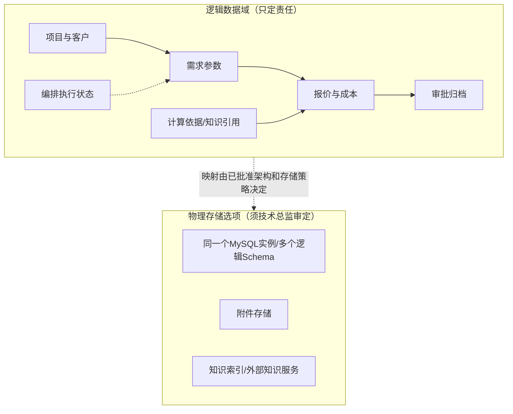

# 报价系统数据库总体骨架示例（候选，不代表已审批）

本阶段只在已审定整体架构的组件与交互关系下确定**业务数据域、归属、存储边界和是否分库分表**，绝不提前写业务表字段或DDL。

## 1. 业务数据域与最终权威

| 数据域 | 主要业务对象 | 在整体组件骨架中的权威归属 | 主要跨域关系 |
|---|---|---|---|
| 项目与客户 | 报价项目、客户、项目生命周期 | 若依业务后台中的项目业务能力 | 给解析任务、报价、审批提供统一项目身份 |
| 需求与参数版本 | 输入资料、解析候选、人工确认参数 | 若依需求业务能力；编排保留任务执行状态 | 已确认版本供匹配和报价引用 |
| 知识与计算依据 | 历史计算单、知识检索来源、匹配结果 | 各自数据Owner须由完整交互骨架确定 | W3知识检索结果不能直接变成正式报价 |
| 报价与成本 | 成本核定、正式报价、输出版本 | 已审定报价业务权威组件 | 引用人工确认参数与计算依据版本 |
| 审批与归档 | 审批状态、人员历史、客户交付物 | 业务审批及归档组件 | 审批不应直接改写执行编排状态 |
| 长任务执行 | Execution、Worker进度、人工暂停/恢复状态 | **统一编排**中已批准的状态Owner | 审批与任务执行状态各自独立、必要时关联 |
| 文件与审计 | 原始上传文件、BOM图纸、导出文件、业务审计 | 文件存储及审计组件，具体物理实例以环境为准 | 文件版本必须与报价引用关系兼容 |

## 2. 数据域不是数据库实例

业务域分成7个，并**不意味着必须有7个数据库**。是否需要多库、分表或独立存储由真实部署与容量、写入/查询模式、合规隔离等证据决定。

## 3. 分库分表的可审查决策（示例表达）

| 决策项 | 对报价系统的候选处理 | 需要确认的事实 | 何时重审 |
|---|---|---|---|
| 独立业务库 | 单机资源有限时优先单MySQL实例，按模块逻辑隔离 | 实际CPU/内存预算、所有权与权限模型 | 安全隔离、独立扩容或业务增长出现真实需求 |
| 业务分库 | **不因W1~W6独立部署就自动分库** | Worker是否拥有独立业务权威、跨库事务成本 | 明确不同业务写入Owner和资源隔离要求 |
| 水平分表 | 无数据量/访问热点证据时不预设分片 | 年增长量、读写峰值、保留年限、索引膨胀 | 单表或实例增长达到已确认容量/性能阈值 |
| 文件/索引独立 | 大文件和知识索引按真实对接要求区分 | 附件年增长、RPO/RTO、知识后端实际位置 | 文件备份/检索需要独立生命周期时 |

**判断关卡**：只输出确定的“采用/暂不采用”及其理由、数值依据和触发条件，不能写“为了未来扩展预留分库分表”却没有可评审边界。模块详细设计才做具体业务表字段、索引、SQL。
