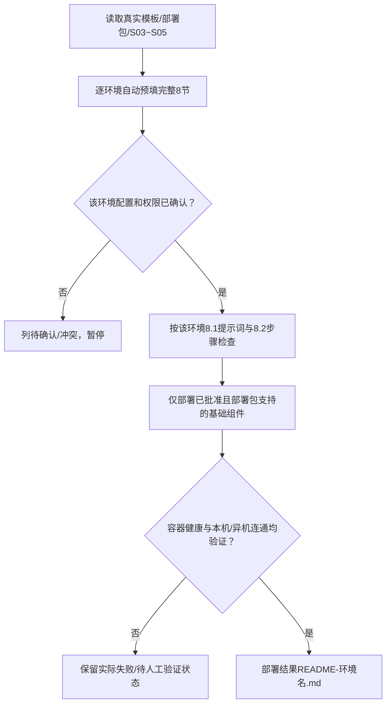

# 报价系统初次部署配置示例

> 假设项目经客户确认存在“开发环境”和“测试环境”两套部署目标。这里展示**如何预填与审核**，不提供真实IP、密钥、命令执行结果，也不意味着项目实际已经具备两个环境。

## 1. 环境识别与独立配置

| 项目 | 开发环境（示意） | 测试环境（示意） |
|---|---|---|
| 唯一模板 | `code/deploy/single-node-docker/初次部署配置.md` | 同一原始模板，只读复制 |
| 本环境配置 | `初次部署配置-开发环境.md` | `初次部署配置-测试环境.md` |
| Compose项目 | `quote-dev`（待核对） | `quote-test`（待核对） |
| 部署目录 | `/srv/quote-dev/`（待核对） | `/srv/quote-test/`（待核对） |
| 宿主端口 | 现场核对端口后填写 | 必须避开开发环境端口 |
| 数据卷与数据库 | 独立dev卷、库名与数据域 | 独立test卷、库名与数据域 |
| Redis/MQ租户隔离 | 独立db/prefix及vhost（适用时） | 与dev不共享写入空间 |
| 敏感配置 | 仅私有 `remote.env.dev` / `.env.dev` | 仅私有 `remote.env.test` / `.env.test` |

模板第1~8节必须完整保留：①组件开关、②自启、③服务器/项目、④端口、⑤数据库/中间件、⑥FTP、⑦初始化SQL、⑧AI执行要求（含8.1、8.2、8.3）。

## 2. 智能预填与缺口

| 待确认项 | 自动获得的内容 | 应如何处理 |
|---|---|---|
| 组件类型和选型 | 从S04/S05已有批准设计读取 | 模板只支持不同DB时立即标冲突，提交技术负责人裁定 |
| 服务器地址/SSH权限 | 仅使用真实环境资料 | 无来源的IP/SSH端口标待确认并给合理候选，不当事实 |
| 端口/旧容器 | 仅远端实测才可得知 | 未授权远端扫描前标待确认，不把示例端口当已空闲 |
| 初始化SQL | 必须从实际脚本目录获得 | SQL不存在/未批准时阻塞，不能虚构脚本或毁旧数据 |
| 口令、Token、私钥 | 不进入Markdown/Git/聊天回显 | 确认时通过安全私有配置注入 |

## 3. 两个独立放行关口

首次只启动授权的数据库、缓存、消息队列、FTP/MQTT等基础组件（按真实架构适用），**不能启动ruoyi/nginx或要求jar/dist已存在**；保留package目录。执行前必须检查Compose项目名、端口、网络、卷、已有数据并保护其他项目，不擅自使用破坏性 `down -v`。

## 4. 产物与证据

- 配置阶段：逐环境独立 `初次部署配置-<环境名称>.md`、缺口/推荐、真实用户确认记录；未经确认不得远程执行。
- 实际执行后：每套环境独立 `部署结果README-<环境名称>.md`，列服务、端口、数据路径、真实健康与另一台电脑IP/端口连通结果；未实际检查的标待人工验证。
- 若项目只有一种环境，仅生成一种环境配置；示例的环境数量、路径和Compose名称均不能照搬。
