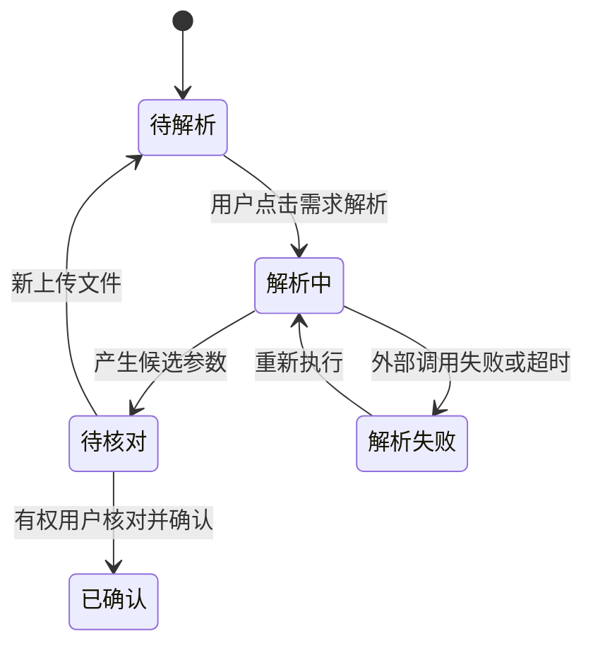

# 报价“需求解析与参数核对”模块——部分详细设计演示

> 演示设计，不是已经核对代码/PRD后的可实施接口合同；具体API和字段由真实源代码/项目决策裁定。

## 业务状态示范

## 一致性规则

- 只有已确认版本的参数才能被计算单匹配引用。
- 上传新文档后只能创建新的解析候选版本，不覆盖先前已确认版本。
- 前端必须复用 code/fld 已有需求解析与核对页面，不为AI接口另做一个完整新页面。
- 若依业务服务核查用户对项目和参数确认操作的授权。

## API契约占位格式（不是实际API）

| 业务动作 | 示例接口 | 权限 | 重要异常 |
|---|---|---|---|
| 发起解析 | POST /api/quote/projects/{projectId}/parse | 项目操作权限 | 任务重复受理、文件不可用 |
| 查询解析状态 | GET /api/quote/parse-tasks/{taskId} | 项目数据可见性 | 找不到任务、已超时 |
| 人工确认参数版本 | POST /api/quote/projects/{projectId}/parameters/{version}/confirm | 参数确认权限 | 版本已变更/重复提交 |

这些路径只是为了说明模块设计文件应该具体到什么程度，不应原样交给开发人员。真实生成时必须先检查后端已有路由和前端调用约定再确定。
