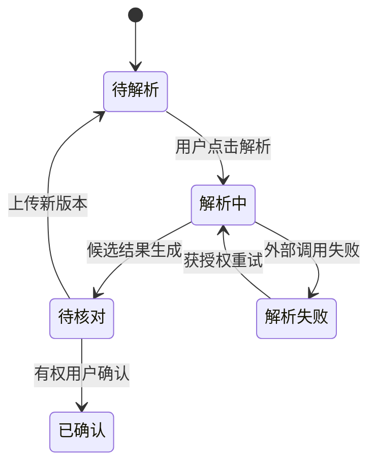

# 报价需求解析与核对——模块详细设计片段（候选）

> 本例展示设计深度，不代表真实项目的API或数据库契约。正式使用前必须核实PRD、现有前端原型、后端路由、S04组件责任和S05核心表/字段/ER。

## 1. 本轮任务及继承条件

| 维度 | 设计检查内容 |
|---|---|
| 本轮场景 | 技术人员上传材料、执行解析、核对并确认版本 |
| 已批准组件 | 需求业务Owner、异步执行组件与现有前端页面（以真实S04为准） |
| 数据契约 | 项目ID、参数版本与确认状态来自已批准S05，不另建同义主表 |
| 外部阻塞 | 解析服务可用性、真实账号及样本是否到位需实际核查 |
| 非目标 | 不在本轮重做统一登录、替换已有视觉或实现完整报价审批 |

## 2. 业务状态和失败分支

正式参数不能被新一轮候选解析静默覆盖；不同用户确认同一版本时必须核验并发冲突和幂等。

## 3. 页面动作与接口契约（仅演示字段完整性）

| 业务动作 | 示例方法及路由（待核实） | 角色/状态限制 | 输入输出与异常 |
|---|---|---|---|
| 执行解析 | POST /api/projects/{projectId}/parse | 项目可操作权限、未重复受理 | 输入资料版本；返回任务ID；文件不可用/重复提交 |
| 查询状态 | GET /api/parse-tasks/{taskId} | 项目数据可见权限 | 返回任务状态、错误码；超时/无任务 |
| 确认参数 | POST /api/projects/{projectId}/parameters/{version}/confirm | 参数确认权限、待核对状态 | 返回新状态及版本；冲突/重复请求 |

## 4. 数据及迁移边界

本模块只能在S05已确认的项目/参数版本身份和表间关联上补充局部字段、索引、唯一/权限过滤约束。需要变更核心字段、状态Owner或关键跨域引用时先回S05；需要更换组件或关键流程先回S04。只输出`迁移设计草案.md`，在实现/TDD时形成版本化SQL并检验。
