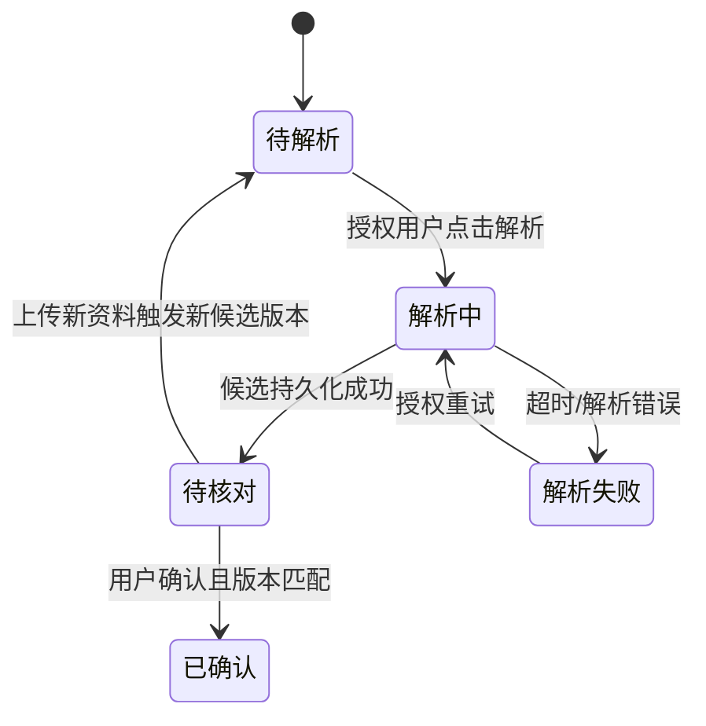

# 报价系统「需求解析与参数核对」模块详细设计示例

> 以下接口、字段与状态均为**讲解设计深度的候选合同**，不是已核对的真实源码或已批准数据库。正式输出前需对照PRD、原型、S04/S05和当前 `code/`。本示例不是可直接执行的迁移DDL。

## 1. 本轮任务范围与依赖


| 项目 | 本轮候选范围 | 放行依据 |
|---|---|---|
| 核心角色场景 | 上传需求、点击解析、查看候选、人工核对与确认版本 | 项目PRD及既有原型 |
| 不做事项 | 不重写原型视觉、不设计报价审批、不重建账号系统 | S04业务职责边界 |
| 上游强依赖 | 有效报价项目ID、业务权限；真实参数确认引用规则 | 模块池与S05权威Owner |
| 可并行契约 | 解析服务请求/结果模型可先约定并模拟验证 | 已批准接口字段与超时规则 |
| 外部受阻 | 真实模型账号、真实测试文件、客户确认口径未到位时受阻 | 不把Mock标为业务验收通过 |

### 1.5 继承总体架构和数据库契约


| 冻结来源 | 模块必须遵守 | 具体校验 |
|---|---|---|
| S04组件/核心链路 | 原型入口→后端鉴权→解析执行→候选持久化→人员核对与确认 | 每个步骤有明确已批准执行组件和业务Owner |
| S04工程复用 | 既有原型页面、后端登录、项目数据权限 | 不另建平行UI或认证体系 |
| S05核心数据 | 项目唯一身份、参数版本唯一性、状态Owner及ER引用 | 不新建同义核心参数版本表 |
| S05版本不变量 | 正式参数确认版本不可被新候选静默覆盖 | 确认更新须查版本冲突并记审计 |

## 2. 业务流程和状态




| 触发 | 前置条件 | 写入Owner与状态影响 | 异常/幂等 |
|---|---|---|---|
| 发起解析 | 项目有效、文件已上传、有权限 | 后端创建执行状态，原有确认版本不变 | 重复请求返回已存在任务或拒绝，真实策略待定 |
| 完成解析 | 结果归属于正确项目与任务 | 写候选参数及版本引用，进入待核对 | 回调重复/乱序须幂等 |
| 确认参数 | 有权限且候选版本未被其他操作替换 | 标记已确认版本并保留原有历史 | 并发确认需版本条件校验 |
| 重试失败 | 原任务处于可重试状态 | 记录失败原因和重试状态 | 不覆盖历史结果 |

## 3. 接口清单

### 3.1 既有原型页面与业务动作映射


| 既有页面（需实际定位） | 用户动作 | 后端行为 | 页面反馈/错误 |
|---|---|---|---|
| 需求文件上传 | 上传文件并点击解析 | 校验权限/文件，受理解析任务 | 返回任务编号，不显示“解析已成功” |
| 参数候选核对页 | 查询任务状态/参数版本 | 只读任务及候选数据 | 解析失败/超时可看到真实状态 |
| 参数确认操作 | 比较版本后确认 | 后端检查权限/并发版本并落库 | 成功显示确认版本，冲突提示重新核对 |

前端只允许在 `code/` 中现有页面完成绑定和必要局部调整，不能另建一套原型视觉。

### 3.2 新增接口合同（示意，不保证实际路由）


| 业务动作 | 方法/URL样例 | 请求与响应核心字段 | 权限/错误与幂等 |
|---|---|---|---|
| 发起解析 | POST /api/projects/{id}/parse | inputFileIds[] → taskId/status | 项目操作权限、重复请求键、超时/文件错误 |
| 查询任务 | GET /api/parse-tasks/{taskId} | taskId → status/candidateVersion | 项目读权限、任务不存在/未完成 |
| 确认参数 | POST /api/projects/{id}/parameters/{version}/confirm | expectedVersion → confirmedVersion | 参数确认权限、版本冲突/重复确认 |

正式接口路径、类型、错误码必须从已存在框架约定与项目PRD核对，不可照抄示例。

## 4. 数据库设计

### 4.1 表汇总、身份与关联


| 表/数据对象 | 字段与类型（MySQL示意，需审定） | 约束与关联 | 是否已冻结 |
|---|---|---|---|
| 报价项目 | `id BIGINT`、`project_code VARCHAR(64)` | project_code业务唯一 | S05核心，引用不重定 |
| 参数版本 | `id BIGINT`、`project_id BIGINT`、`version_no INT`、`status VARCHAR(32)` | project_id逻辑引用项目；(project_id, version_no)唯一 | S05核心，需实际核对 |
| 解析任务（辅助候选） | `id BIGINT`、`project_id BIGINT`、`request_key VARCHAR(128)`、`error_reason VARCHAR(512)` | request_key幂等唯一、关联项目 | 本模块待详细设计 |

**迁移设计草案**：首先核实存量表及索引→仅新增必要列/辅助任务表→定义历史数据回填与回滚方案→设计真实验收；暂不执行SQL。若开发时SQL与草案有变化，反向修订并审核，S12再生成版本化迁移脚本。

### 4.2 新增与扩展字段

此处候选解析任务需在真实DDL核对后补全字段类型、必填/默认值、关联、唯一性、索引及归档策略；现有核心表仅引用批准的数据契约，不重写第二套表。此示例不能代替正式模块字段表。

## 5. 本阶段代码目录树

以下文件路径是**需项目代码扫描后替换的占位示意**，绝不代表项目现有文件真实存在：

```text
code/
├── <已存在前端原型目录>/                 # 复用页面结构与样式，新增任务查询/核对交互
│   └── <既有需求核对页面文件>            # 仅增量接入真实后端API
└── <已有后端工程目录>/
    ├── <需求解析接口或服务扩展点>          # 权限、任务受理、状态与版本条件写入
    └── <真实测试源码目录>/
        └── <幂等与并发版本集成测试>        # 第6章测试接缝，验证可重复失败后修复
```

## 6. 性能资源与测试接缝


| 质量判据 | 适用验证 |
|---|---|
| 未授权用户不能确认其他项目参数 | 用后端鉴权API的正/反向自动测试 |
| 同一解析回调不能生成重复候选或覆盖确认版本 | 幂等/乱序集成测试 |
| 长任务请求应及时返回受理状态而非一直占用HTTP连接 | 有真实队列与任务环境时验证 |
| 原型布局和人工核对体验 | 独立人测记录，不能由AI声称已经通过 |
| 资源/时限 | 继承项目基线确定的具体负载/时长，不填猜测数值 |

## 7. 验收标准

| 角色 × 核心场景 | 通过条件 | 证据来源 |
|---|---|---|
| 授权人员上传需求并点击解析 | 只创建合法任务，页面显示受理状态而非虚假完成 | API自动测试＋真实页面人工验证 |
| 无权限人员读取或确认其他项目 | 数据隔离生效，拒绝操作且不泄露参数 | 反向鉴权测试 |
| 技术人员确认候选参数版本 | 版本一致才允许确认，重复回调或并发冲突不覆盖历史 | 幂等/并发集成测试＋人工签收 |
| 客户代表检查需求核对页面 | 继续沿用原型视觉，按实际数据完成核对 | 原型对比＋真人测试记录 |

**设计审核与交接**：项目经理确认本轮场景和验收结果；开发负责人检查接口、迁移草案、环境依赖；技术总监校验S04/S05冻结项。仅高代价未决决策按需内部调用 `grill-with-docs`；重大Owner/核心关系变化返回S04/S05审查。正式维护 `.scratch/<module_key>/模块详细设计.md`（第1章包含本轮范围与依赖、第4章包含必要的迁移设计思路），并按真实进度维护项目总控；不再额外创建范围检查或迁移草案文件。S10再根据已确认设计形成Spec。
