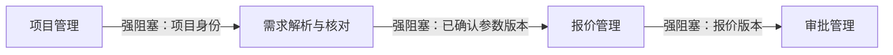

# 报价系统模块识别示例（候选，不代表真实项目已批准）

本例演示 `module-discovery` 的判断依据。模块数不根据菜单、页面、数据库表或开发Ticket数量预设；必须根据项目完整PRD和已有工程再审核。

## 1. 角色×场景发现候选能力

| 角色×核心场景（示例） | 可观察业务结果 | 候选归属 |
|---|---|---|
| 业务员创建项目并维护客户资料 | 项目身份与状态可被检索 | 项目管理 |
| 技术人员上传资料并确认参数 | 产生可追溯的已确认参数版本 | 需求解析与核对 |
| 报价人员基于确认版本编制报价 | 报价版本及计算依据可追溯 | 报价管理 |
| 审批人处理提交、驳回及重提 | 有权限控制与完整审批历史 | 审批管理 |

## 2. 拆合与职责边界

| 候选模块 | 职责与非职责 | 核心对象/状态Owner（待核实） | 为什么合并或拆分 | 独立验收结果 |
|---|---|---|---|---|
| 项目管理 | 管理项目主身份；不代替报价计算 | 项目主状态：项目业务组件 | 项目身份被多个场景共享，权威必须唯一 | 可建档、检索和授权查看 |
| 需求解析与核对 | 解析候选、人工确认；不代替正式报价 | 参数版本及确认状态：需求业务组件 | 候选、核对、确认属同一参数生命周期，优先合并 | 已确认参数版本可追溯 |
| 报价管理 | 成本核定、报价版本；不独立审批 | 报价版本：报价业务组件 | 与参数版本有关联，但报价是可独立验收的业务结果 | 正确生成并追踪报价版本 |
| 审批管理 | 处理审批状态与历史；不改写报价内容 | 审批状态/记录：审批业务组件 | 审批角色、规则及状态生命周期独立 | 通过、驳回、重提记录完整 |

如审批和成交归档具有相同业务Owner和紧密耦合的生命周期，可以合并；反之具备独立结果、权限和状态Owner时可拆分。需由项目经理与技术总监根据真实PRD裁定。

## 3. 依赖关系（只是候选）

接口契约可冻结的协作可并行开发，真实集成验收仍须通过实际数据链路。第三方设备、外部Worker或权限未到位属于外部阻塞，不能冒充内部模块依赖。

## 4. 审核交付

实际应产出 `项目模块清单.md`、`模块依赖关系.md`、`模块拆分审核.md`，逐PRD场景确保一个主责模块、无无依据能力，并保留拆/合决策、业务覆盖补删改和Owner审查证据。本阶段不生成开发Tickets。
