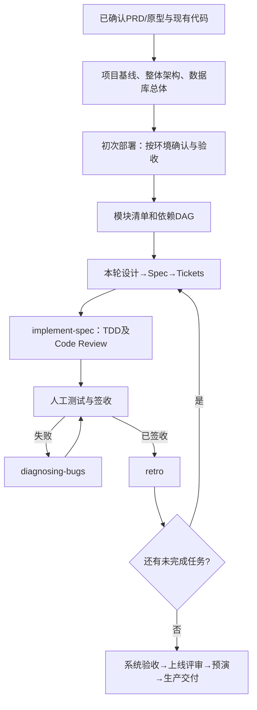

# 研发工作流输入输出与质量门禁

本文定义当前执行标准，不记录设计修改过程；预期产物不是已执行完成的证据。

## 全流程

## 全部步骤的交付契约

| 步骤 | Skill或动作 | 输入来源 | 预期产物 | 放行条件 |
|---|---|---|---|---|
| **0. 准备工作** | | | | |
| S00A 项目资料 | 资料准备 | docs/input/需求资料/；docs/input/工程资料/ | 无新增文件 | 输入真实可查 |
| S00B 现有代码 | 资料准备 | code/ | 无 | 输入真实可查 |
| **1. 项目准备与设计** | | | | |
| S01 项目输入核验 | 资料准备 | docs/input/；code/ | 会话内：输入资料清单及已读结论；会话内：缺失、互相矛盾、无法读取或需要补充确认的项目 | 输入真实可查 |
| S02 Skills 初始化 | setup-matt-pocock-skills | code/；docs/input/工程资料/ | AGENTS.md；docs/agents/issue-tracker.md | 输入真实可查 |
| S03 项目基线 | project-baseline | docs/input/需求资料/；docs/input/工程资料/ | docs/output/01-项目基线/项目基线前置约束确认表.md；docs/output/01-项目基线/项目基线.md | 只定约束，关键值审批 |
| S04 整体架构设计 | architecture-baseline | docs/input/；docs/output/01-项目基线/项目基线.md | docs/output/02-整体架构/整体架构设计.md；docs/output/02-整体架构/架构评审记录.md | 组件和关键业务链双核心 |
| S05 数据库总体设计 | data-architecture | docs/input/；docs/output/01-项目基线/项目基线.md | docs/output/03-数据库总体/数据库总体设计.md；docs/output/03-数据库总体/数据库设计审核.md | 规则/数据流/核心表字段及ER |
| S06 初次部署 | development-environment | code/deploy/single-node-docker/初次部署配置.md；code/deploy/single-node-docker/ | code/deploy/single-node-docker/初次部署配置-<环境名称>.md；待确认问题、推荐理由与用户对每套配置的明确确认记录 | 按环境预填、审批、执行、验收 |
| S07 业务模块拆分 | module-discovery | docs/input/；docs/output/01-项目基线/项目基线.md | docs/output/05-模块拆分/项目模块清单.md；docs/output/05-模块拆分/模块依赖关系.md | 职责/对象生命周期/依赖DAG |
| **2. 模块迭代开发** | | | | |
| S09 本轮模块设计 | module-design | docs/input/全部本轮相关资料；docs/output/05-模块拆分/项目模块清单.md、模块依赖关系.md | docs/output/06-模块迭代/<模块>/任务/<任务标识>/本轮范围与依赖检查.md；docs/output/06-模块迭代/<模块>/模块详细设计.md | 任务与依赖就绪，继承S04/S05 |
| S10 编写 Spec | to-spec | 本轮角色×场景、PRD/原型、已有代码、GLOSSARY与ADR；docs/output/06-模块迭代/<模块>/任务/<任务标识>/本轮范围与依赖检查.md | .scratch/<模块>/<任务标识>/spec.md | 独立Spec及测试接缝 |
| S11 拆分 Tickets | to-tickets | .scratch/<模块>/<任务标识>/spec.md；docs/output/06-模块迭代/<模块>/任务/<任务标识>/本轮范围与依赖检查.md | .scratch/<模块>/<任务标识>/issues/NN-*.md | 纵向票及阻塞边经过Quiz |
| S12 TDD 实现与审查 | implement-spec | .scratch/<模块>/<任务标识>/spec.md 与 issues/；docs/output/06-模块迭代/<模块>/模块详细设计.md 与迁移设计草案.md | code/；database/migrations/ | TDD/集成分支/原版代码审查 |
| S14H 人工测试与签收 | manual-testing | 当前独立Spec/Tickets及已确认PRD的角色×核心场景；docs/output/06-模块迭代/<模块>/模块详细设计.md 和当前code/ | docs/output/06-模块迭代/<模块>/任务/<任务标识>/人工测试用例与结果.md；docs/output/06-模块迭代/<模块>/任务/<任务标识>/模块验收与状态记录.md | 人执行/回填/签收，失败不通过 |
| S14B Bug 诊断与修复 | diagnosing-bugs | docs/output/06-模块迭代/<模块>/任务/<任务标识>/人工测试用例与结果.md；错误日志/截图/重现步骤 | docs/output/06-模块迭代/<模块>/任务/<任务标识>/Bug根因与六阶段诊断记录.md；真实修复、回归测试与原始故障消失的证据 | 原版六阶段Bug反馈环 |
| S15 开发会话复盘 | retro | 本轮实际AI编码会话、可读取的Git Diff/提交、CI和工具执行记录；AGENTS.md/CLAUDE.md、代码规范、测试与自动化守卫 | Matt官方retro根据真实证据提供的开发导航、守卫、规范和工具改进建议；用户明确批准后才实际调整Agent约定/CI/规则 | 真实编码会话复盘 |
| **3. 全项目验收与部署上线** | | | | |
| S16 系统业务验收 | system-acceptance | docs/input/需求资料/；docs/output/05-模块拆分/项目模块清单.md | docs/output/07-系统验收/业务场景覆盖矩阵.md；docs/output/07-系统验收/系统验收报告.md | PRD角色场景跨模块验收 |
| S17 上线就绪评审 | release-readiness | docs/output/01-项目基线/项目基线.md；docs/output/02-整体架构/整体架构设计.md | docs/output/07-系统验收/性能安全检查.md；docs/output/07-系统验收/上线评审结论.md | 非功能指标实测与技术批准 |
| S18 上线预检与预演 | release-preflight | docs/input/环境资料/；docs/output/01-项目基线/项目基线.md | deploy/docker-compose.yml；deploy/nginx/ | 真实备份恢复及回滚预演 |
| S19 生产部署与交付 | release-delivery | docs/output/08-上线交付/部署预演.md；docs/output/08-上线交付/备份回滚方案.md | docs/output/08-上线交付/上线记录.md；docs/output/08-上线交付/交付清单.md | 授权生产部署及交付签收 |

## 无法绕过的边界

- 项目基线只定义工程约束；整体架构同时固定组件/工程结构和端到端业务链；数据库总体锁定整体规则、关键数据流、核心字段及ER。
- 初次部署必须逐环境从真实八节模板预填、分别经用户批准后再执行；配置生成不等于部署成功。
- S07划分业务模块，不提前生成实现Tickets；S09只深化本轮任务，不改变总体Owner、协议、核心字段/ER。
- S10/S11/S12直接使用Matt原版；原版TDD与最终Code Review有真实命令/审查证据才可宣称通过。
- 人工测试结果与业务签收由真实人员回填；Bug必须按原人工用例ID复测；retro不取代业务签收。
- 系统验收根据本项目PRD角色场景生成，不硬编码报价、设备或审批；上线前的非功能、备份恢复与回滚必须实测。

## 审核责任与证据保留

| 角色 | 必须核准内容 |
|---|---|
| 项目经理 | 业务场景、模块归属、人工业务验收与客户签收 |
| 技术总监 | 项目约束、整体架构/数据冻结、非功能和发布放行 |
| 开发人员 | 真实工程、模块设计、代码/测试/部署执行结果 |

本仓库规范文件保持当前状态而无历史修订日志；真实项目Git记录、需求变更、迁移、Bug首次失败及复测、签收审计必须保留。
