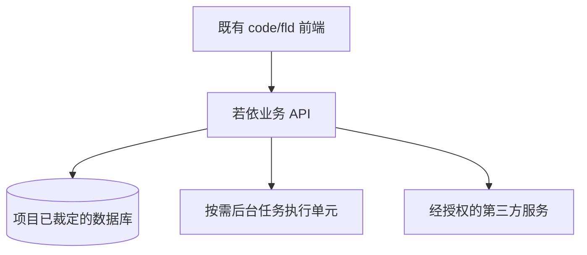

# 整体架构设计

## 1. 总体结构及运行边界

按实际方案删除不需要的运行单元。仅画程序边界，不按页面切分。

## 2. 运行单元与职责

| 单元/进程 | 必须承担 | 不应承担 | 部署与资源预算（引用基线） |
|---|---|---|---|

## 3. 跨单元交互与协议

| 发起方→接收方 | 数据/动作 | REST或异步 | 鉴权/幂等/超时与失败行为 |
|---|---|---|---|

## 4. 全局身份和数据责任

| 数据/状态 | 最终权威方 | 变更入口 | 权限及版本约束 |
|---|---|---|---|

## 5. 主业务链与异常链验证

| 已确认角色×场景 | 涉及单元 | 成功状态路径 | 失败/驳回/回退路径 |
|---|---|---|---|

## 6. 部署拓扑及容量检查

| 运行节点 | 资源上限 | 端口与网络 | 日志、备份和恢复路径 |
|---|---|---|---|

## 7. 架构决策与不可逆取舍

只记录真正存在方案取舍的决策，引用对应 `docs/adr/` 文件。

## 8. 评审结论

| 技术总监评审点 | 已检查证据 | 通过/退回 |
|---|---|---|
