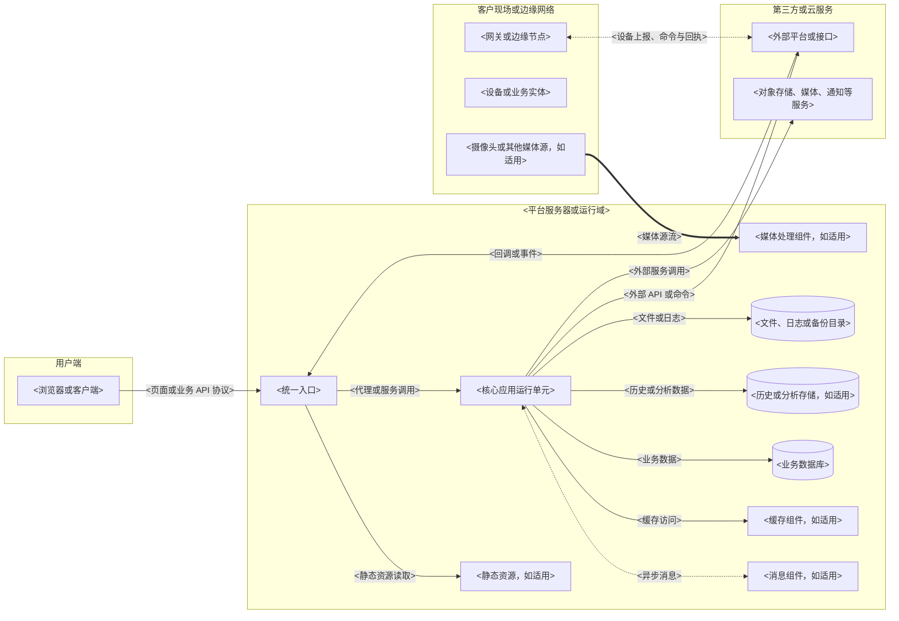
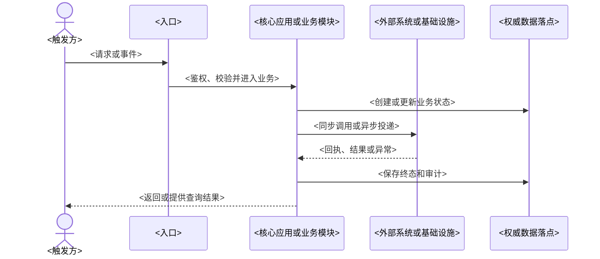

# <系统名称>整体架构设计

> 本文用于在开发前建立系统全景技术基线：第一章明确系统所处环境和限制，第二章列全架构级组件并核对组件关系，第三章规定影响架构的容量与关键参数，第四章说明这些组件如何部署、保护和运行。

填写原则：

- 只写开发前需要确定并已确认的设计结论，不写当前验证状态、事实类别、取证过程、审核过程和历史旧结论。
- 架构组件必须列全。浏览器、入口、应用、消息、缓存、数据库、文件、媒体、第三方平台、网关、设备等实际存在的对象不得遗漏。
- 组件关系必须能从图或关系表直接核对。协议、方向、传输内容和成功边界必须明确。
- 模板中的组件和链路只用于提示结构，正式文档必须按项目实际替换；不适用内容直接删除。
- 五章结构保持不变；按证据启用IoT、Agent、第三方等专项，不强制引入与本项目无关的技术或服务。
- 已批准的技术版本、容量及留存继承项目基线，不能因示例将它们写成实际环境。

# 1. 系统概述

## 1.1 系统背景

使用 2 至 4 句话说明建设背景、要解决的核心问题、系统目标和主要使用环境。不要在本节展开功能清单、技术细节或论证过程。

<填写系统背景。>

## 1.2 系统边界

本节分别说明系统负责什么、不负责什么。需求范围外、由第三方平台完成、由现场设备执行或无法由本系统判定的结果必须写入“系统不负责”。每项使用 `1、2、3、4` 的条目形式表述，不使用表格。

### 1.2.1 系统负责

1、<本系统负责的业务能力、数据处理或控制职责。>

2、<本系统负责维护的数据、状态或业务结果。>

3、<本系统负责提供的接口、流程或运行保障。>

4、<其他属于本系统建设范围的职责；没有时删除本条。>

### 1.2.2 系统不负责

1、<由第三方平台、外部系统或云服务负责的事项。>

2、<由现场设备、硬件、固件或物理机构负责的事项。>

3、<由人工操作、现场条件或其他责任方判定的结果。>

4、<明确不在本期范围内的能力；没有时删除本条。>

## 1.3 关键技术指标

只列必须满足且能够验收的指标。指标值来自需求、正式确认或容量设计，不设置指标编号，不写当前验证值或当前结论。

| 指标项 | 目标值 | 对架构的约束 | 验收标准 |
| --- | --- | --- | --- |
| <并发、吞吐、延迟、可用性、数据保留或其他指标> | <明确数值或范围> | <该指标要求哪些组件、链路或资源采用什么设计> | <满足指标时的判定方式> |

## 1.4 服务器与环境信息

列出开发、测试、生产以及必要的公网、内网、边缘或托管资源。服务器规格、网络入口、承载内容和存储要求必须与第二章拓扑和第四章部署设计一致。

| 环境 | 资源与运行方式 | 网络入口 | 承载内容 | 存储要求 |
| --- | --- | --- | --- | --- |
| <环境或节点> | <CPU、内存、操作系统、容器或托管方式> | <域名、端口、代理或网络区域> | <部署的组件和用途> | <数据盘、持久化、日志和备份要求> |

## 1.5 技术选型

只列本项目采用的技术和产品。互斥方案不得并列，尚未采用的备选技术不进入有效选型表。

| 层级或能力 | 技术或产品 | 版本或实例 | 用途 | 选型约束 |
| --- | --- | --- | --- | --- |
| <前端、后端、消息、缓存、数据库、设备协议、媒体、文件、部署等> | <技术或产品> | <版本、版本范围或服务实例> | <在本系统中的用途> | <必须遵守的使用边界或禁止项> |

## 1.6 外部环境与对接对象

本节说明系统外部环境中的对象，不局限于第三方接口。网关、设备、摄像头、第三方平台、云服务、现场系统和其他外部实体均按项目实际列出；没有外部对象时写“无”。

| 外部对象 | 类型 | 基本信息与业务作用 | 所在位置或网络 | 与本系统关系 | 对接说明 |
| --- | --- | --- | --- | --- | --- |
| <对象名称> | <网关、设备、摄像头、第三方接口、云服务或其他> | <型号、平台、用途等必要背景> | <公网、局域网、现场、云端等> | <上游、下游、双向或外部依赖> | <协议、接口、回调、消息、文件或媒体方式概述> |

# 2. 总体架构设计

本章的目标是列全组件并核对组件之间的关系。图和表应相互校验：图用于查看整体结构和主关系，组件清单用于防遗漏，关系总表用于核对协议、方向和责任边界。

## 2.1 总体架构视图

### 2.1.1 全局架构拓扑

使用一张平铺式拓扑图展示用户端、平台服务器或运行域、第三方云、客户现场等实际区域。不得为了减少交叉线把全局拓扑拆成多张图；不得把代码模块误画成独立网络服务。

绘图要求：

- 图中必须包含所有架构级运行组件和外部对象。
- 组件之间直接连线，在线上写明协议、方向或传输内容，不使用关系编号替代说明。
- 控制面、数据面、媒体面和文件面按真实路径绘制；数据面绕过核心应用时必须明确。
- Mermaid 节点保持平铺，不在服务器区域内再嵌套逻辑分层。
- 下图只示范结构，正式文档必须按项目组件和关系全部替换。



拓扑图后用一段文字说明生产运行形态、统一入口、同机或跨机边界、不能误解为独立服务的代码模块，以及不经过核心应用的直连链路。

### 2.1.2 分层架构设计

分层架构使用等宽字符框图格式，表达代码职责和依赖方向，不使用流程图。每层列出本项目真实模块或能力，不存在的层直接删除。

```
┌═══════════════════════════════════════════════════════════════════════┐
║                         <表现或客户端层>                             ║
║  <页面、客户端模块、状态管理、请求封装等>                            ║
╚═══════════════════════════════════════════════════════════════════════╝
                                      │
┌═══════════════════════════════════════════════════════════════════════┐
║                         <入口与鉴权层>                               ║
║  <统一入口、认证、权限、参数校验、代理等>                            ║
╚═══════════════════════════════════════════════════════════════════════╝
                                      │
┌═══════════════════════════════════════════════════════════════════════┐
║                         <业务与编排层>                               ║
║  <核心业务模块、任务编排、状态机等>                                 ║
╚═══════════════════════════════════════════════════════════════════════╝
                                      │
┌═══════════════════════════════════════════════════════════════════════┐
║                         <接入与异步层>                               ║
║  <外部适配、协议解析、消息生产消费、重试和死信等>                    ║
╚═══════════════════════════════════════════════════════════════════════╝
                                      │
┌═══════════════════════════════════════════════════════════════════════┐
║                         <数据与基础设施层>                           ║
║  <数据库、缓存、消息、文件、媒体、第三方和现场资源>                  ║
╚═══════════════════════════════════════════════════════════════════════╝
```

| 逻辑层 | 组成 | 核心职责 | 输入与输出 | 依赖方向 | 不负责事项 |
| --- | --- | --- | --- | --- | --- |
| <层名称> | <模块、包或能力> | <本层负责的职责> | <主要输入和输出> | <允许依赖的下层> | <必须留给其他层或外部对象的职责> |

分层说明必须明确：外部协议在哪里转换为领域模型，权限在哪里校验，事务和异步边界在哪里，业务终态由谁判定，缓存与权威存储如何区分。

### 2.1.3 工程组织、现有代码复用与允许依赖

本节必须根据真实的 `code/` 目录和构建/模块配置填写；扫描已有路由、原型、布局与公共组件、前端请求封装、后端认证/角色/数据权限及文件、字典等能力。**已有工程不重建、原型样式不重写。** 不能以案例子目录冒充真实路径。

| 实际工程及目录 | 已有能力、真实文件证据 | 新增业务的代码落点/扩展接口 | 必须复用或禁止改变 |
| --- | --- | --- | --- |
| <前端工程> | <路由、页面、布局、组件、API等文件> | <业务页面、组件、API适配放哪里> | <已有原型视觉、导航、公共组件> |
| <后端工程> | <权限、Controller/Service、公共功能、包模块> | <业务模块、包层及扩展点> | <不能重建认证、文件、数据权限等> |
| <其他真实工程> | <实际证据> | <按需扩展> | <禁止绕过接口直接修改外部能力> |

```text
code/                         # 根据项目真实工程填写，不预设子目录名
└── <已有工程>/               # 每项标记原有或拟扩展，按职责列主模块
    ├── <已有公共能力>        # 复用，不重新造轮子
    └── <业务扩展模块>        # 符合原工程结构；不列逐页面或逐Java类
```

| 发起模块/层 | 允许依赖的对象 | 禁止依赖及原因 | 允许的跨边界接口 | 校验方式 |
| --- | --- | --- | --- | --- |
| <前端业务页面> | <原型现有UI、请求封装> | <复制登录、绕开统一API封装> | <已有或审定的业务API> | <路由、导入、调用抽查> |
| <业务服务模块> | <已有公共能力和公开接口> | <跨模块内部Mapper/表、循环依赖> | <公开Service/事件/REST等实际契约> | <工程依赖和代码审核> |

此处确定工程级骨架和依赖方向，不提前列出全部Controller、DTO、Mapper、SQL和页面内部组件。逻辑代码模块与实际独立进程/容器须和后面的组件及部署清单对应。

## 2.2 组件清单与关系总表

**组件清单**

组件清单覆盖图中的全部节点以及必须独立说明的核心代码模块。组件与模块要区分：独立进程、容器、托管实例和外部实体属于运行组件；Java、前端或其他工程内部的职责单元属于代码模块。

| 组件ID/名称 | 类型及运行形态 | 业务职责与非职责 | 已有/新建/外部及代码依据 | 主要交互 | 业务状态/数据Owner | 部署位置 |
| --- | --- | --- | --- | --- | --- | --- |
| <C01/真实组件> | <逻辑组件/进程/外部实体> | <负责与不负责> | <代码文件/输入资料> | <调用方与被调用方> | <权威归属或无> | <同进程/独立部署/外部> |

**组件关系总表**

关系总表不设置关系编号。全局拓扑中的每条跨组件关系都应在表中出现；表中新增的架构关系也必须回到全局拓扑核对是否需要画出。

| 发起方 → 接收方 | 触发场景与协议 | 身份与核心输入/输出 | 同步/异步及业务成功判定 | 超时/失败/重试/取消 | 状态Owner与追踪 |
| --- | --- | --- | --- | --- | --- |
| <组件A→组件B> | <真实场景与协议> | <授权范围、关联ID、必要内容> | <受理与完成区别> | <何时停止、幂等、补偿> | <谁保存终态、requestId/业务ID> |

## 2.3 关键端到端链路

本节只选择影响架构边界、业务成功判定或跨组件协作的关键链路。每个 `2.3.X` 小节必须先放一张图，再写设计规则；不得只有文字或表格没有图。

候选链路包括但不限于：浏览器访问与业务查询、设备上报与解析、控制下发与回执、平台摄像头、本地摄像头、文件上传、通知、认证会话/受保护访问、删除停用。只保留项目实际存在的链路。

### 2.3.X <关键链路名称>



| 设计点 | 规则 | 失败边界 |
| --- | --- | --- |
| <权限、入口、状态、数据、幂等、回执、重试、媒体、文件或其他关键点> | <必须遵守的设计规则> | <失败、超时、重复、晚到或外部不可用时如何结束> |

链路图和规则必须说明：

- 触发方、入口、主要参与组件和权威数据落点。
- 请求受理、消息投递、平台 ACK、业务回执、权威状态和最终成功的区别。
- 权限、幂等、超时、重试停止条件、失败终态和人工处理边界。
- 数据面或媒体面是否经过核心应用。
- 可用于测试和验收的业务结果。

## 2.4 关键数据存储与业务结果判定

本节说明关键数据保存在哪里、由谁写入和使用，以及重要业务结果由什么数据判定。缓存、消息 ACK、第三方平台受理状态和页面显示不能直接替代最终业务结果。

| 数据或业务结果 | 保存位置 | 写入或更新方 | 使用方 | 判定规则 |
| --- | --- | --- | --- | --- |
| <主数据、实时数据、历史、告警、控制结果、会话、文件、媒体会话或其他关键对象> | <数据库、对象存储、缓存、内存或外部系统> | <负责写入或更新的组件> | <读取或依赖该数据的组件> | <覆盖、追加、去重、恢复、对账或最终成功的判定方式> |

## 2.5 业务场景架构覆盖与专项适用性

PRD中每一类核心**角色×场景**必须能映射到唯一主责组件、主要协作组件、真实工程扩展位置、关键交互、数据Owner和权限/失败路径。可合并同构CRUD，但不能遗漏审批、设备控制、人工确认、第三方失败等不同边界。

| 角色×核心业务场景 | 前端入口/主责组件及代码落点 | 协作组件与协议 | 关键状态/数据Owner | 越权/失败处理 |
| --- | --- | --- | --- | --- |
| <真实业务场景> | <原型页面/模块与组件ID> | <组件A→组件B/方式> | <谁是权威> | <拒绝、补偿、恢复责任> |

| 专项架构 | 实际触发对象或资料 | 适用性 | 启用后必须在全景/关系/时序/部署体现的内容 |
| --- | --- | --- | --- |
| 普通Web与审批 | <真实页面、审批、长任务或文件> | <启用/不适用> | <既有UI权限、审批Owner、异步业务状态等> |
| 工业IoT | <设备、网关、物联网云或现场数据> | <启用/不适用> | <采集解析、测点和时间戳、补传去重、告警、控制回执、安全> |
| Agent/知识检索 | <模型、Agent、知识库、MCP、HITL> | <启用/不适用> | <执行Owner、工具权限、模型配置、人工确认、结果可信性> |
| 第三方集成 | <ERP/MES/MOM/Worker/API/只读库等> | <启用/不适用> | <协议与身份、同步周期、失败、最终结果及责任边界> |

允许专项叠加。不适用的类型写明证据并删掉无关空章节；专项启用后必须在前文的真实组件、交互和部署设计中体现，不能只在此处写“已覆盖”。

# 3. 关键运行参数和值

本章只保留会影响容量、资源分配、跨组件行为、故障处理或验收结果的参数。逐接口、逐队列、逐 Key、逐 SQL、逐字段和普通框架配置下沉到专项设计或部署配置。

## 3.1 负载与容量模型

| 负载对象 | 设计基准 | 影响组件 | 设计要求 |
| --- | --- | --- | --- |
| <用户、设备、请求、消息、文件、媒体、历史增长或其他负载> | <数量、频率、峰值、大小、持续时间或容量公式> | <受到影响的组件和链路> | <资源、隔离、积压恢复、存储或验收要求> |

容量模型至少核对入口、应用、消息、数据库、存储和外部依赖。没有依据的项目不编造数值，应在第五章列为剩余问题。

## 3.2 关键架构参数

| 参数对象 | 设计值 | 影响关系 | 设计约束 |
| --- | --- | --- | --- |
| <线程、连接池、限流、超时、重试、消息、缓存、数据库、设备协议、文件、媒体、日志或保留策略> | <开发前确定的值或范围> | <受影响的组件和链路> | <采用该值必须满足的安全、可靠性、资源或业务规则> |

关键参数必须写具体值、范围或明确公式。参数未确定且会影响组件关系、容量、安全、部署或验收时，进入第五章，不在表中伪造默认值。

# 4. 部署、安全与运维设计

## 4.1 部署设计

本节按第二章中的生产运行组件逐项填写，说明每一项部署在哪里、如何配置、依赖什么、如何验收以及失败时如何处理。不得只写“使用 Docker 部署”“配置健康检查”等无法执行的概述。

| 部署项 | 部署位置和方式 | 关键配置 | 持久化与资源 | 网络和依赖 | 验收标准 | 失败处理 |
| --- | --- | --- | --- | --- | --- | --- |
| <服务器基础环境、编排网络、入口、静态资源、应用、消息、缓存、数据库、设备 Broker、媒体、文件、第三方服务、配置凭据、启动顺序等实际部署项> | <节点、容器、进程、托管服务或外部平台> | <端口、目录、运行参数、启动顺序或配置原则> | <卷、数据盘、CPU、内存、进程数、保留与清理> | <开放范围、上游、下游和外部网络> | <部署完成后必须通过的检查> | <失败时停止、降级、回滚或恢复方式> |

## 4.2 安全设计

| 安全域 | 设计要求 | 执行位置 | 阻断规则 | 审计与监控 | 验收标准 |
| --- | --- | --- | --- | --- | --- |
| <认证会话、权限数据范围、高风险操作、外部鉴权、网络存储、日志脱敏、依赖治理等> | <必须满足的安全规则> | <组件、模块或平台> | <不满足时如何拒绝或停止> | <需要记录和监控的内容> | <安全检查通过标准> |

## 4.3 运维与可观测性

| 观测对象 | 日志与指标 | 告警条件 | 运维动作 | 关联标识和记录 |
| --- | --- | --- | --- | --- |
| <入口、应用、消息、数据库、缓存、设备协议、第三方、媒体、文件或日志任务> | <关键日志、指标和事件> | <何时告警> | <定位、限流、隔离、扩容、补偿或回滚动作> | <requestId、traceId、业务键、任务号、消息键等> |

补充日志保留、轮转、归档、清理、容量和敏感信息扫描要求。临时诊断日志必须说明启用范围和关闭方式。

## 4.4 备份、恢复与应急

| 对象 | 备份要求 | RPO / RTO | 恢复顺序和判定 |
| --- | --- | --- | --- |
| <数据库、消息、缓存、对象存储、本地文件、应用、静态资源或配置> | <备份内容、周期、保留和位置> | <目标值或不适用> | <恢复顺序、验证内容和成功判定> |

| 故障场景 | 自动隔离或降级 | 人工处理 | 恢复判定 |
| --- | --- | --- | --- |
| <入口、应用、消息、数据库、缓存、网络、第三方、设备、媒体或文件故障> | <自动停止、限流、降级或隔离策略> | <运维处理步骤> | <恢复后必须重新验证的业务和数据> |

# 5. 架构冻结、风险与剩余问题

## 5.1 A/B/C架构冻结清单

必须写**已确认的具体决策**，而非笼统口号。A：顶层组件/工程组织/跨组件协议/数据Owner/统一权限/部署边界，仅技术总监批准后可改变；B：原型复用/允许依赖/异常/日志等全局兼容规则；C：模块内表字段、API参数、Controller、页面局部实现，可在S09/S12决定。

| 级别 | 对象与已确定结论 | 禁止行为 | 允许怎样扩展 | 约束验证与变更责任 |
| --- | --- | --- | --- | --- |
| A | <该项目已批准的主要组件或权威Owner> | <不得擅改的边界> | <按现有组件的扩展接口增加业务> | <技术总监审批并同步受影响设计> |
| B | <已有UI、公共服务、依赖等已定规则> | <不得重复建设/反向依赖> | <兼容性扩展> | <代码审核与例外评审> |
| C | <本模块内部可设计部分> | <不得违反A/B> | <字段/DTO/实现细化> | <S09模块设计> |

## 5.2 后续继承与架构变更路线

| 后续阶段 | 在现有骨架上允许细化 | 必须先回S04复审的情况 |
| --- | --- | --- |
| S05 数据库总体 | 数据域、库/存储与容量策略 | 新增权威数据Owner、顶层存储组件 |
| S06 环境建设 | 按已确认部署拓扑配置和实际验证 | 新增独立服务、改变主要网络与资源边界 |
| S07 模块拆分 | 根据组件Owner、已有代码与依赖分模块 | 新增未经批准的顶层组件或协议 |
| S09 模块详细设计 | API参数、业务表/索引、页面局部逻辑、迁移草案 | 改变A级组件/协议/权限/状态Owner |
| S12 实现与审查 | 继承既定工程组织和全局规则的增量实现 | 越界引入新服务、越权读写或重做公共模块 |

变更流程：记录触发原因、现行方案和替代方案、对场景/代码/数据/部署/安全的影响及兼容/回滚措施 → 技术总监裁决 → **先更新本架构与必要ADR** → 同步受影响的下游设计及验证后才能实施。B级兼容例外可按指定负责人审查，C级细节正常迭代。

## 5.3 架构风险、阻塞与剩余问题

无影响整体架构定稿的问题时写“无”。存在高影响未决项时整体架构只能标为**候选/待审核**，不得宣称冻结完成。

| 问题/假设 | 影响场景与组件 | 建议处理或验证方法 | 责任方 | 是否阻断S04 |
| --- | --- | --- | --- | --- |
| <真实缺失的接口合同、服务器资源或授权> | <组件及交互> | <补资料、最小验证或内部Grill裁决> | <项目经理/开发/技术总监> | <是/否及理由> |

# 附件

## 附件 A 名词与缩写

| 名词或缩写 | 定义 |
| --- | --- |
| <名词> | <本项目中的准确含义> |

除“附件 A 名词与缩写”外，不固定其他附件名称和数量。根据项目实际需要增加附件 B、附件 C 等内容；没有实际内容的附件不得保留占位章节。

<!-- 生成约束：调用整体架构Skill内部Grill确认影响组件/交互的未决决策。未确认的关键事项应在第五章公开列明，不能当作正式架构结论。 -->
