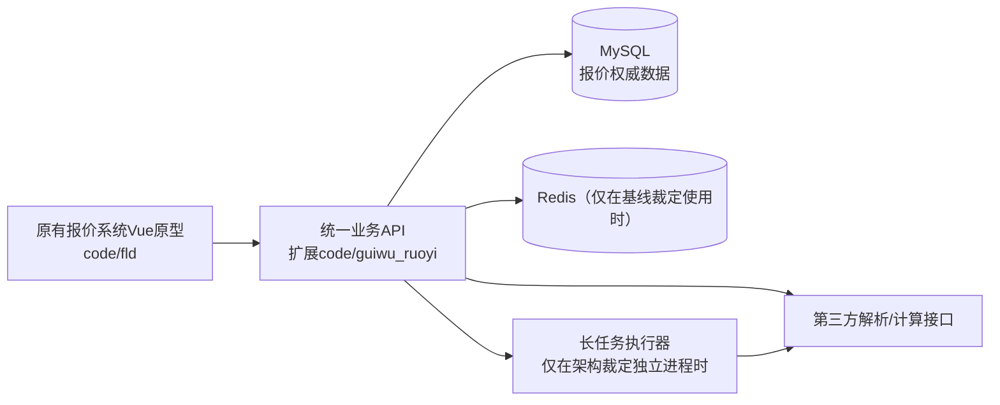

# 报价系统整体架构速览（示例，不是该项目的已审批设计）

## 运行单元

## 关键责任

| 边界 | 由谁负责 | 关键禁止事项 |
|---|---|---|
| 前端Vue原型 | 复用既有页面、交互和主题，调用统一API | 不重建页面视觉体系 |
| 若依业务API | 登录、数据权限、业务状态、审批一致性、报价版本与审计 | 不将权限判断交给浏览器或AI |
| 后台任务 | 长耗时解析的实际状态，防重复、超时、取消与恢复 | 不将任务受理显示成业务完成 |
| 第三方 | 只使用真实已确认的接口能力 | 不将模拟结果标为已完成对接 |

## 实际设计前仍必须判断

是否确需独立Worker、用不用消息中间件、客户服务器能否容纳、审批实现方案是否已定，都必须由项目基线、PRD和Grill中裁定；不能把示例中的虚框当作真实建设承诺。
