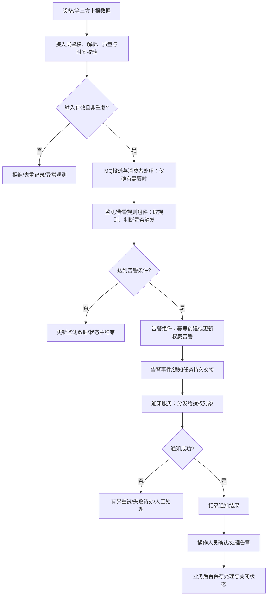

# 核心业务链路：架构级端到端处理与组件双向核验

## 1. 为什么单有组件拓扑还不够

组件拓扑回答“有什么、谁连谁”，核心链路必须回答“**一笔业务、一个事件或一次任务实际怎么跑**”。组件图中只有“外部平台→后端→MQ→数据库”不等于告警处理链：它遗漏了数据校验、条件判定、去重、权威告警写入、通知及后续闭环。**每个关键链路都必须体现业务处理阶段，不能用服务器节点串联代替业务处理流程。**

## 2. 识别哪些链路必须画

从PRD核心角色×场景、原型业务动作、设备与第三方对接合同，建立**核心链路目录**。选择原则：

- **必选（实际存在时）**：贯穿项目主业务从触发到结果的闭环；数据/事件流入并触发业务处理；会改变重要业务状态/产生告警/订单/报价等的规则链；重要外部结果交接；跨组件且包含异步等待/人工确认/审批/设备控制的链路。
- **按需**：文件归档/导出、批处理/报表、通知/订阅、权限敏感操作、异常重算和恢复，只有独立业务结果或架构差异时单列。
- **可合并**：只换查询条件或CRUD表单、相同组件和状态语义的同构流程；不为每个菜单画一张图。
- 核心链路的**数量由真实业务决定**，不固定为3条、5条或按模块/菜单逐条列；未确认链路须注明候选/阻断，不能混入冻结结论。

链路目录表字段：
`链路名称 | 触发场景/角色 | 起点和最终业务结果 | 主责组件 | 主要参与组件 | 同步/异步/外部边界 | 必须覆盖的异常出口 | PRD依据`。

## 3. 每条链路的最低设计单元

先以 **Mermaid flowchart（处理流程图）** 展示“触发→接入/授权/校验→转换/异步缓冲（如需）→业务判断→权威持久化→后续动作/通知（如需）→反馈/确认→成功/失败/恢复闭环”。不同项目顺序不同，**不是固定流水线**，业务规则决定分支。

| 必须明确 | 具体问题 |
| --- | --- |
| 触发与入口 | 哪个用户/设备/系统在什么条件下开始？由谁接收，是否鉴权或去重？ |
| 处理顺序与分支 | 解析/转换/规则判定/聚合/审批/人工确认在哪里执行？哪些条件会结束或走另一条分支？ |
| 步骤Owner与交接 | 每个动作由哪个组件ID/业务模块负责？进出哪些数据/事件？跨组件怎么传（同步、消息、文件、回调）？ |
| 数据和状态 | 哪一时点落库/存文件？谁拥有业务终态、执行状态或通知发送状态？如何区分已受理/已持久化/已交付？ |
| 后续动作与闭环 | 何时通知、下发指令、生成文件或等待人工处理？谁反馈最终结果、确认/关闭/归档？ |
| 异常恢复 | 失败、超时、重复、乱序、设备离线、通知失败、重复回调、人工未处理怎样退出、重试、补偿或留下待办？ |
| 约束与验收 | 按项目基线的实时性、容量、留存、审计限制，系统如何判定业务最终完成？ |

每条链路交付：**一张处理流程图（必须）＋跨组件时序图（必要时）＋步骤责任表＋状态/异常/完成判定规则**。至少选一个重要异常分支在图中真实画出，其他可在异常表中列明。时序图描述请求/消息/结果的时间顺序，不能取代规则判断处理图。**不在本阶段细化字段级DTO、SQL、告警阈值参数明细或具体Java算法**，这些由S09/S12决定；但必须确定“告警由谁判断、采用何种条件来源、结果由谁持久化、何时通知”等架构级决定。

步骤责任表：
`处理步骤 | 执行组件ID与真实代码接缝 | 核心输入→输出/事件 | 同步/异步与协议 | 写入的数据/状态Owner | 正常成功条件 | 失败/重试/恢复`。

## 4. 告警处理示范（非真实项目已核实方案）

**候选链路（存在消息缓冲和通知时）**：

注意：
- MQ不是必须。没有峰值削峰、异步隔离或既有队列要求时，可以采用同步处理，**不能凭示例新增RabbitMQ/独立Worker**。
- “数据到达/接入ACK”≠“条件触发告警”；“告警持久化成功”≠“通知成功”；“通知成功”≠“人员已处理”。这些状态必须分开管理。
- 若使用异步消费者，至少确定消息幂等标识、消费确认与持久化边界、重试/死信处理；**告警落库与通知投递的可靠交接**可比较事务Outbox、消息重试或已有一致性机制，按项目资源及风险选择，不强制所有项目采用Outbox。
- 对超时、乱序或迟到的设备数据，要依据时间戳、规则和数据保存/补传约束制定处理原则；具体数据表、阈值配置等留S09。
- 若没有通知/告警确认流程，删掉这些步骤；不要为了“流程完整”额外发明需求。

## 5. 双核心双向一致性矩阵

| 链路/处理步骤 | 主责组件/代码落点 | 组件间交接关系 | 权威数据/状态Owner | 失败/恢复 | 反向依据 |
| --- | --- | --- | --- | --- | --- |
| <告警上报/解析/去重/判断/落库/通知/确认> | <Cxx和真实工程目录> | <发起方→接收方、协议、业务事件> | <组件与持久化位置> | <重试/补偿/人工出口> | <PRD场景/接口合同> |

审核两遍：

1. **链路→组件**：所有步骤（包括解析、业务判断、状态持久化、通知）都有组件与真实接口；错误/恢复步骤同样有Owner，条件分支与成功判定可操作。
2. **组件→链路**：每个主要业务组件必须能在至少一条核心链路中找到职责，或归为有证据的公共认证、存储、监控等基础能力；没有依据的运行单元删除或合并。

两边不一致时，**先补流程或调整组件职责，再同步组件图、交互矩阵、部署和A/B/C冻结**，不允许独立修改一份图。

## 6. 常见误区

- 只有“组件架构图”，缺少业务判断和状态闭环。
- 有处理流程，但节点只有“后端”或“数据库”，不知道哪个逻辑组件/已有代码负责。
- 每条链路都是理想成功路径；遗漏重复、超时、通知丢失、回调晚到。
- 错把消息投递或第三方ACK视为业务成功。
- 为了让图看起来专业而强制加入队列、缓存、OSS或微服务。
- 把S04画成逐个模块详细设计、算法步骤和表字段清单，破坏层级。
