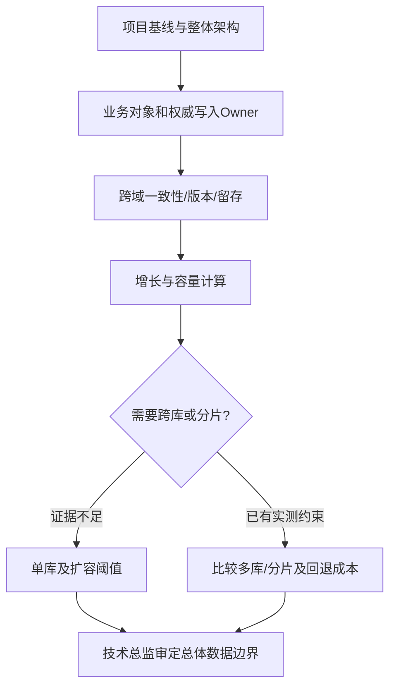

# 数据库总体设计

## 输入与设计层级

递归读取 **`docs/input/` 下全部相关原始资料**（需求/工程/环境/对接和新增类别）、`docs/output/01-项目基线/项目基线.md`、**已审定的** `docs/output/02-整体架构/整体架构设计.md`（全部组件、交互矩阵、数据Owner和部署边界）及既有GLOSSARY/ADR。只负责数据库**总体**：领域、所有权、分库存储策略、可追溯与扩容策略。模块迭代的具体业务表、字段、索引与SQL不在本阶段制作。

## 核心约束

此处是**对整体架构的存储维度细化**：先从已定组件/交互矩阵取得数据Owner、运行单元和跨边界访问，再确定数据域、存储介质/库和分库分表条件。**不得反过来擅自增加或删除系统组件、修改Worker交互或跨系统协议。**确有缺失的高成本数据架构取舍时，Skill内部按需调用官方 `grill-with-docs`（它会使用grilling及domain-modeling），仅澄清新增未决数据责任或存储选型；已确认项目基线、组件和交互不再重问。若问题改变上层架构，退回architecture-baseline技术总监审核。

## 执行步骤

1. **从总体组件/交互中识别数据域**：先读取Owner和跨组件的数据调用，再从真实业务闭环识别项目/客户、词典、需求输入和确认参数、历史计算单、匹配结果、成本、报价版本、审批、归档、审计、附件元数据等。按谁是最终写入权威划分责任，而不是按菜单划库。
2. **确定一致性和所有权**：识别跨域共享ID、引用方向和不可删除对象；明确参数人工确认后如何保持版本追溯、报价与审批状态如何原子变更（只定原则不设计表）。
3. **选库与边界**：读取基线中已批准的MySQL版本、单机资源、并发量与保存年限，提出默认单库/多schema/多库/分片的适用条件。无明确容量与隔离需要时优先简单方案，不能为“先进”无根据地分库分表。
4. **容量和访问模式**：依据当前存量、每年增长、记录与附件存储方式、常见读取/写入路径推算容量等级；缺少行大小或归档年限应提出关键补充问题，不能用记录数硬算磁盘大小。
5. **存储分层与安全**：区分事务数据、附件原文、缓存和业务审计的权威性；确定按版本保存、数据留存起算、备份恢复范围、历史删除禁止约束。
6. **骨架一致性与后续契约**：数据库总体设计必须反向关联整体架构的组件ID及“发起方→接收方+协议/场景”组件关系（不另编交互ID），说明数据在哪个已批准组件被写入/使用；按 [数据库总体评审](references/data-boundary-gate.md) 判断总体域和库边界是否满足基线与架构；技术总监通过后锁定给模块详细设计使用。

## 输出

- `docs/output/03-数据库总体/数据库总体设计.md`
- `docs/output/03-数据库总体/数据库设计审核.md`

参考 [模板](assets/data-architecture-template.md)。

## 明确不做

不写MySQL建表语句、字段类型、外键、分表规则SQL、索引清单、Mapper/Entity。若讨论分库分表，仅给是否采用的有依据决策、键选择原则、触发指标与回退成本，不提前生成分片DDL。

## 数据总体的决策图

给出项目实际的主对象/版本/审批（如适用）/附件/审计等实际使用的数据域矩阵 `Owner | 读写角色 | 权威来源 | 一致性级别 | 保存起点/年限 | 备份恢复`；用基线的年增长、保留周期、索引膨胀与备份空间校验预算。只有数据量、隔离性、扩容代价等客观因素才触发分库分表；字段、索引与具体DDL留给模块详细设计。
