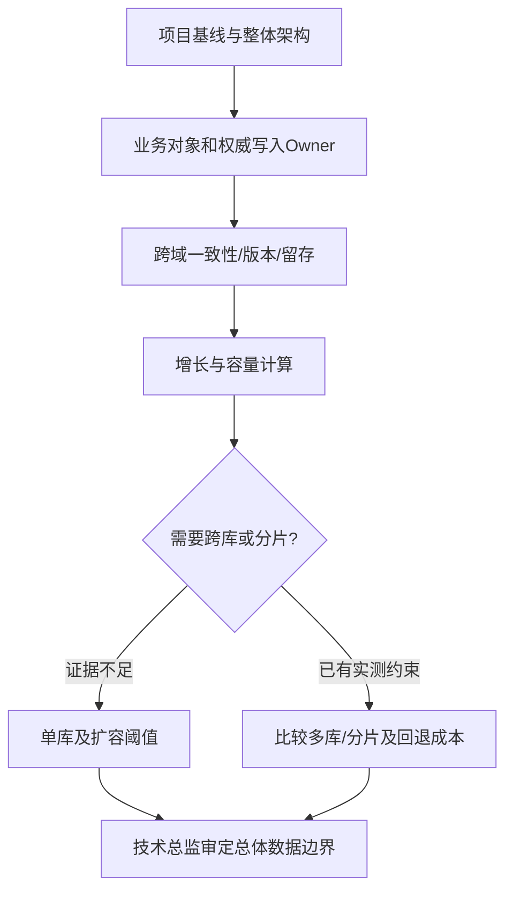

# 数据库总体设计

## 输入与设计层级

读取：`docs/output/01-项目基线/项目基线.md`、`docs/output/02-整体架构/整体架构设计.md`、`docs/input/需求资料/`下已确认PRD、`docs/input/环境资料/`的容量规格及必要的`docs/input/对接资料/`。只负责数据库**总体**：领域、所有权、分库存储策略、可追溯与扩容策略。模块迭代的具体业务表、字段、索引与SQL不在本阶段制作。

## 执行步骤

1. **划分数据域**：从真实业务闭环识别项目/客户、词典、需求输入和确认参数、历史计算单、匹配结果、成本、报价版本、审批、归档、审计、附件元数据等。按谁是最终写入权威划分责任，而不是按菜单划库。
2. **确定一致性和所有权**：识别跨域共享ID、引用方向和不可删除对象；明确参数人工确认后如何保持版本追溯、报价与审批状态如何原子变更（只定原则不设计表）。
3. **选库与边界**：读取基线中已批准的MySQL版本、单机资源、并发量与保存年限，提出默认单库/多schema/多库/分片的适用条件。无明确容量与隔离需要时优先简单方案，不能为“先进”无根据地分库分表。
4. **容量和访问模式**：依据当前存量、每年增长、记录与附件存储方式、常见读取/写入路径推算容量等级；缺少行大小或归档年限应提出关键补充问题，不能用记录数硬算磁盘大小。
5. **存储分层与安全**：区分事务数据、附件原文、缓存和业务审计的权威性；确定按版本保存、数据留存起算、备份恢复范围、历史删除禁止约束。
6. **评审和后续契约**：按 [数据库总体评审](references/data-boundary-gate.md) 判断总体域和库边界是否满足基线与架构；技术总监通过后锁定给模块详细设计使用。

## 输出

- `docs/output/03-数据库总体/数据库总体设计.md`
- `docs/output/03-数据库总体/数据库设计审核.md`

参考 [模板](assets/data-architecture-template.md) 与 [报价数据域示例](examples/报价业务数据域示例.md)。

## 明确不做

不写MySQL建表语句、字段类型、外键、分表规则SQL、索引清单、Mapper/Entity。若讨论分库分表，仅给是否采用的有依据决策、键选择原则、触发指标与回退成本，不提前生成分片DDL。

## 数据总体的决策图

给出项目/需求版本/报价/审批/附件/审计等实际使用的数据域矩阵 `Owner | 读写角色 | 权威来源 | 一致性级别 | 保存起点/年限 | 备份恢复`；用基线的年增长、保留周期、索引膨胀与备份空间校验预算。只有数据量、隔离性、扩容代价等客观因素才触发分库分表；字段、索引与具体DDL留给模块详细设计。
