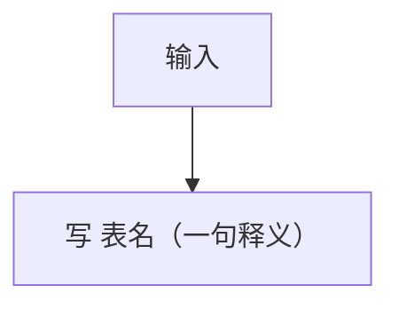

# 数据库总体设计

> 一句话：在分模块开发前，定出全项目共用的**数据骨架**——规则、关键数据流程、核心表与核心字段及关系。
> 本文用**表、字段、键、关系**说话；组件/协议/时序属 S04，此处只引用其结论，不重画。正文只写结论，**不写来源/依据列**（证据留评审）。
> **章节要求编号**（1、1.1…）；规则/条目本身不加代号。图/表必须填真实内容；空表视为未完成。状态：待审定。

## 1. 整体数据规则

> 按 `references/rule-catalog.md` 的固定清单逐条填「本项目结论」；一行一条、1–2 句、只写结论。未触发写「不适用」。

| 规则项 | 本项目结论 | 冻结 |
|---|---|---|
| 命名规范 | | |
| 表名前缀（tb_/tr_/tl_） | | |
| 主键 | | |
| 业务唯一键 | | |
| 外键与引用 | | |
| 数据类型与字符集 | | |
| 时间与时区 | | |
| 空值与默认 | | |
| 计量与精度 | | |
| 状态与枚举 | | |
| 逻辑删除 | | |
| 不可变历史 | | |
| 审计字段 | | |
| 版本与归档 | | |
| 写入 Owner | | |
| 事务与最终一致 | | |
| 幂等与并发 | | |
| 索引 | | |
| 多租户/权限隔离 | | |
| 敏感字段保护 | | |
| 容量与保留 | | |
| 存储分层与拆分 | | |
| 备份与恢复 | | |
| 迁移与演进 | | |
| 注释 | | |
| 大字段与附件外置 | | |
| 明细/快照/聚合的界线 | | |
| 项目专项（按触发） | | |

## 2. 关键数据业务流程

### 2.1 数据域划分

> 用一张 Mermaid 图：节点＝数据域，边＝域间关联，边上标连接键与方向；图下一句话写依据与作用。

```mermaid
flowchart LR
  %% 节点＝数据域；边＝域间关联（键，方向）
```

**依据与作用：** 一个域＝**一族同生命周期的核心对象**，以「**权威写方 / 保留边界 / 一致性边界**」判定；**关系表（tr_）不单独成域**，归入它服务的对象族所在域；框架对象族与其业务扩展表服务同一对象族时同域（域内按表标注写方）。域数保持精简，能合则合；只有对象族、保留或写方边界确实不同才独立成域。作用是归口、边界、落位。

### 2.2 关键数据流程

> 逐域复制本小节；每条流程：**流程图画表名并括号释义** ＋ **表动作矩阵**。控制类/状态机类同样按表画。

**域：____｜流程：____**



| 步骤 | 涉及表（写/读） | 字段/状态变化 | 写入 Owner | 一致性/异常 |
|---|---|---|---|---|

**不变量、正常/异常终态、历史追溯点：** 待真实业务决策。

## 3. 分库分表设计

**判定：** 是否分库/分表/分区、证据与量化触发条件。

> **需要时给完整设计**（写到可落地）：分的方式（水平/垂直、范围/哈希）、分片键与分片表清单、**每个分片表的表结构**（分片键列、唯一键含分片键、表名后缀）、路由方式、全局唯一 ID、跨片查询与聚合、扩容再平衡、与主从/备份恢复的关系。
> 不需要时写「暂不分库分表」＋触发条件与复评指标（含大表的时间 RANGE 分区列与表结构变化）。

## 4. 核心表、核心字段与关联关系

### 4.1 核心表清单

| 表名（贴前缀） | 业务对象/职责 | 已存在/新建 | 业务身份键 | 数据域/Owner | 保留与删除边界 |
|---|---|---|---|---|---|

### 4.2 核心字段

**表名（业务对象/Owner）：** 待填。

| 字段名 | 类型（单位/精度） | 业务含义 | 必填/空值 | 唯一/状态/版本/引用约束 |
|---|---|---|---|---|

> 只列核心字段；不写整表 DDL、不铺开非核心属性与完整索引。

### 4.3 核心 ER 图与关系契约

> ER 用**分域小图**（每域 2~6 个表一张 Mermaid `erDiagram`）；再配一张关系契约表。每条关系写成 `主体表.字段 —(基数)→ 被引用表.字段`。

**域：____**


| 主体表.字段 —(基数)→ 被引用表.字段 | 关系理由/场景 | 删除、修改、历史引用约束 |
|---|---|---|

### 4.4 规则、流程与表字段核验

| 规则/不变量 | 数据流程 | 数据步骤 | 核心表与字段 | 关联/Owner | 下游模块 | 通过/缺口 |
|---|---|---|---|---|---|---|

## 5. 存储与容量

| 数据域/核心表 | 实例/Schema/其他存储 | 读写模式与峰值 | 增长/保留/估算假设 | 扩容触发 |
|---|---|---|---|---|

## 6. 数据安全、生命周期与迁移支撑

| 数据/核心表 | 权限/敏感保护 | 版本与归档删除 | 备份/恢复 | 变更兼容及回退 |
|---|---|---|---|---|

## 7. 全局冻结与模块交接

| 级别 | 已审定全局决定 | 不允许改什么 | 允许下游补什么 | 变更路径/验证 |
|---|---|---|---|---|
| A | 核心身份、跨域关系/Owner、状态版本与存储权威 | 不得模块私自改核心键/状态归属 | 在既定核心关系下扩展 | 技术总监重审 S05，涉及组件先重审 S04 |
| B | 全局命名、精度、隔离、迁移规则 | 不得破坏兼容与历史 | 兼容方式扩展 | 相应责任人复核 |
| C | 模块专属字段、辅助表、普通索引 | 不得突破 A/B | 由 S09/S12 设计并验证 | 模块级审核 |

**待裁定清单**（与上游冲突时列出，不擅自改写）：| 问题 | 推荐方案 | 影响的流程/表/字段 | 决策人/下一步 |

**审核结论**（过程记录，不单独成文件）：| 轮次 | 角色 | 结果 | 未过项 |

> **模板约束（F05/F10/F24）**：正式状态只能 `approved`；未获批准不得给下游当冻结输入。新增表默认 tb_/tr_/tl_，既有 sys_* 保留；任何逻辑删除唯一性须验证两轮重建删除；跨时区事件保留来源时间语义；ER每域2～6表仅为排版建议。