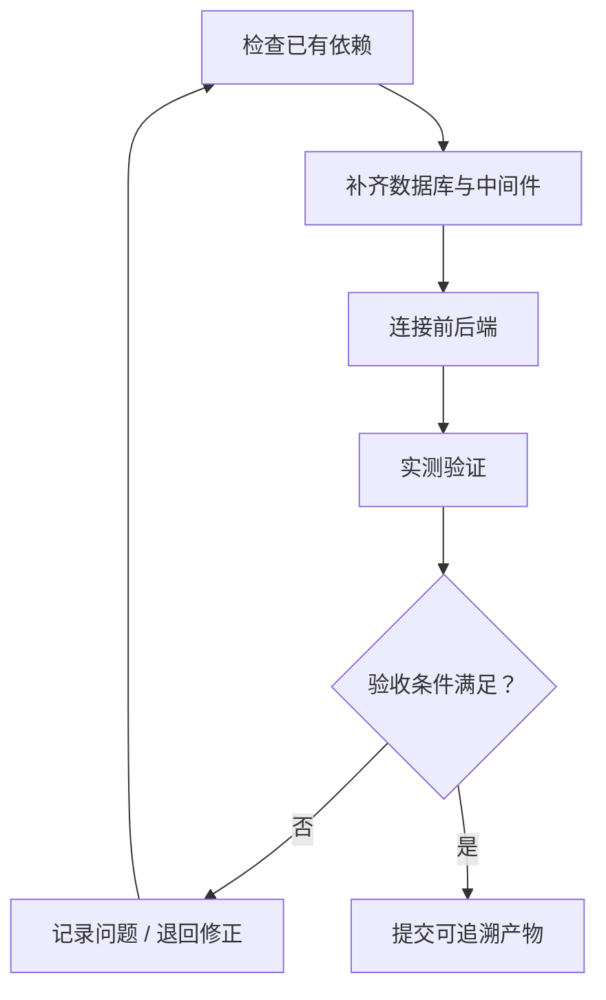

# 开发环境部署

> 类型：自建  
> 参考：obra/superpowers / skills/verification-before-completion/SKILL.md  
> 来源：[GitHub 源文件](https://github.com/obra/superpowers/blob/main/skills/verification-before-completion/SKILL.md)  
> 本文是针对项目场景的原创实现说明，并非上游 Skill 原文。

## 一、职责与边界

本 Skill 只负责「开发环境部署」，从确定的输入形成可审核输出，不越权替代其他步骤。  
项目原型基线是 `code/fld/`；后端框架是 `code/guiwu_ruoyi/`。PRD 位于 `docs/input/需求资料/`，其他可选输入位于 `docs/input/工程资料/`、`docs/input/环境资料/`、`docs/input/对接资料/`。不重做已确认PRD，不独立设计另一套前端视觉与交互体系。Git提交说明使用中文。

## 二、触发条件

当前研发工作流执行到「开发环境部署」，且存在所需输入或已记录的阻塞项时调用。无权访问或无法验证时明确给出阻塞状态，不虚构结果。

## 三、输入

- `docs/output/02-整体架构/整体架构设计.md`
- `docs/output/03-数据库总体/数据库总体设计.md`
- `docs/input/环境资料/`
- `D:/company/environment/（有则优先复用）`
- `code/fld/`
- `code/guiwu_ruoyi/`

## 四、执行流程

### 执行准则

1. **检查已有依赖**：读取对应上下文和实际证据，检查与前序项目基线的关系，记录决定和异常。
2. **补齐数据库与中间件**：读取对应上下文和实际证据，检查与前序项目基线的关系，记录决定和异常。
3. **连接前后端**：读取对应上下文和实际证据，检查与前序项目基线的关系，记录决定和异常。
4. **实测验证**：读取对应上下文和实际证据，检查与前序项目基线的关系，记录决定和异常。

只有确实需要才部署MySQL/Redis等组件。先探测已有资源，所有启动连接结果以实际命令为证据。

## 五、输出

- `docs/output/04-开发环境/开发环境部署与验收.md`
- `按需：deploy/dev/docker-compose.yml`
- `按需：deploy/dev/.env.example`

## 六、验收与中止条件

开发人员实际核验数据库和必要中间件，验证已有前后端连接成功；未实测不得宣称完成。

若输入文档不支持技术结论、第三方接口未确认、实测环境不可达，应输出待确认项并中止受阻部分。产出必须与本项目的PRD、源码和工程基线一致。

## 七、示例和模板

- [使用示例](./examples/使用示例.md)
- [输出模板](./templates/输出模板.md)

## 八、参考与差异

参考项目：obra/superpowers（[源文件](https://github.com/obra/superpowers/blob/main/skills/verification-before-completion/SKILL.md)）。参考其结构化验证、计划或质量关卡思想；本技能额外增加报价项目目录、前端原型守护、角色审核及可追溯产物要求。