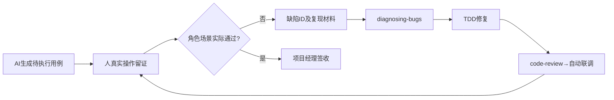

# 人工测试与业务验收

## 1. 职责

当前模块已完成代码审查和自动联调后执行。AI 可以整理用例和证据，**测试动作、实际观察与签收由人完成**。这不是“让AI写一份已通过的测试报告”。

输入：模块Spec和已确认模块PRD、现有原型及对应实际实现、自动联调记录、可运行开发环境和测试账号（凭据不入文档）。

## 2. 选择人工验证范围

依据 [人工测试范围与判定](references/manual-test-checklist.md)，只把AI不能可靠验证或需要真实操作判断的事项放到人工测试：
- 原型与真实页面的视觉/可用性判断、复杂输入组件、边界布局、弹窗/焦点/滚动和移动设备表现。
- 按真实角色观察按钮可见性、权限拒绝、审批领取/驳回/重提和业务状态变化。
- 真实文件/第三方/设备交互、人工对照计算或导出结果、浏览器与客户环境差异。
- 所有本轮重要角色×业务场景，正常、异常和回退路径按风险覆盖。

已通过且有证据的自动化用例不要求机械重新点一遍，重点核对AI无法确认的事实。

## 3. 测试执行与留证

1. AI依据角色×场景生成 [人工测试单](templates/人工测试与缺陷单.md)，写好前置条件、操作、预期结果、证据栏，初始状态全部为“待执行”。
2. 开发人员按用例亲自操作，填写通过/不通过/阻塞/不适用；按步骤、时间、环境、截图/日志和实际结果记录证据。
3. 发现Bug创建缺陷ID，写可复现步骤、预期/实际、影响范围、严重性和关联的Spec/Ticket。
4. 不通过 → 调用 `diagnosing-bugs` 建立准确失败反馈环 → 通过 `implement-spec` / `tdd` 修复 → 必须重跑 `code-review` 和自动联调 → 开发人员复测原人工用例及相关回归。
5. 若是需求歧义或第三方未落实，不作为普通Bug私自修改PRD；回到对应阶段提案并经项目经理确认。
6. 所有阻断或高风险缺陷关闭、未执行项有明确批准的处理结果后，项目经理按角色×场景签收本轮模块。

## 4. 完成门禁

允许通过：已执行用例有真实证据，关键场景通过，缺陷关闭有复现→修复→复测记录；受限测试明确标注，不冒充真实通过。

不允许通过：只有AI生成的“通过”表、只有自动化测试结果、只有开发者自述、原型明显改版、权限越权、实际Bug未复测。

## 5. 输出

- `docs/output/06-模块迭代/<模块>/人工测试与缺陷单.md`
- `docs/output/06-模块迭代/<模块>/人工场景验收记录.md`

参考 [测试单模板](templates/人工测试与缺陷单.md) 与 [报价模块执行示例](examples/报价需求解析人工测试示例.md)。

## 人工执行、失败回环和签收

人工测试单必须包含：角色、浏览器/设备、原型参考、前置数据、操作步骤、预期、实际观察、截图/日志、结果、缺陷ID。AI预生成的每条状态**只能是待执行**。人工发现的问题先分“确定性Bug/需求歧义/第三方受限”：Bug进入诊断并回审查与联调；歧义返回Grill或PRD确认；受限单列未测，须项目经理决定是否阻断。只有真实复测记录才可关闭Bug。输出 `人工测试与缺陷单.md` 与 `人工场景验收记录.md`，不得将自动化通过替代人工签收。
