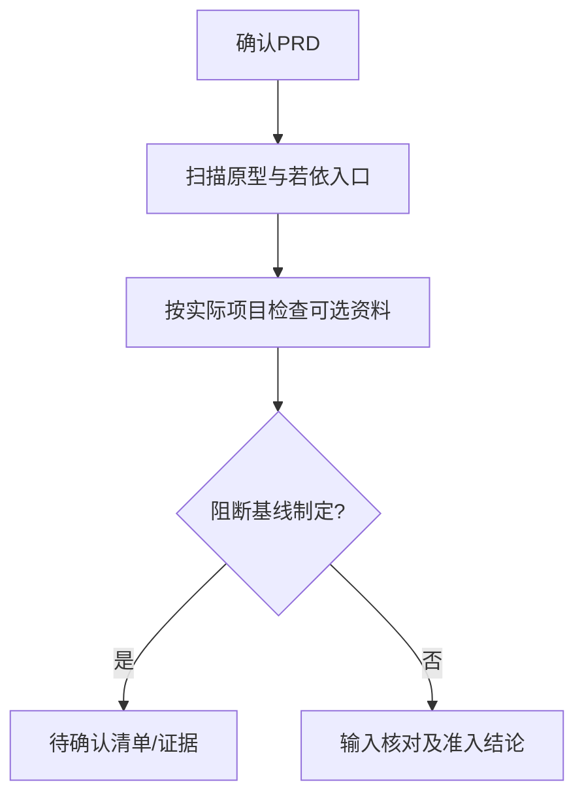

# 首次项目输入就绪确认

## 1. 工作目标与输入

判定项目能否进入Matt初始化和工程基线。资料缺失不等于全部阻塞；只有影响下一步的真实歧义才阻塞。

- `docs/input/需求资料/`
- `docs/input/工程资料/`
- `docs/input/环境资料/`
- `docs/input/对接资料/`
- `code/fld/`
- `code/guiwu_ruoyi/`

## 2. 具体操作

1. 查证 docs/input/需求资料/ 下确有已确认的项目PRD，记录文件名/版本/确认状态，无法找到时不得称为已交付。
2. 检查 code/fld/ 已有可供研发的前端原型，code/guiwu_ruoyi/ 是原有后端框架的入口，**只确认存在**，不做Ruoyi源码质量评审。
3. 工程、环境和对接资料按实际需要标注：没有第三方则没有对接资料可以通过；环境资料未到位时标记会不会影响基线的部署条件。
4. 逐项区分“必须阻塞下一步”和“可后补”，让项目经理只确认真正会改变业务/数据/目标环境的缺口。

## 3. 审核与失败路径

**关卡**：无已确认PRD或原型目录不可读、业务目标相互矛盾才阻塞进入下游；可选资料不存在不应机械阻塞。

输入资料并不自动等于事实已确认，实际程序运行没有命令与输出不能填“已通过”；所有技术建议均以本项目已确认基线和PRD为准。

## 4. 交付文件

- `docs/output/01-项目基线/输入核对.md（简明核对）`
- `docs/output/01-项目基线/待确认事项.md`（无阻断时记录无需补项）

## 5. 支持文件

- [专属审核标准](references/execution-gate.md)
- [交付模板](assets/output-template.md)
- [报价系统场景示例](examples/报价项目场景示例.md)

## 可执行快速检查

必须对照 PRD 的角色、模块与关键业务链检查版本及批准人，记录“路径—核验命令/人工确认—状态—阻断影响”。工程/环境/对接资料为**按实际需求条件性输入**，不得将缺少未用到的第三方资料视为阻塞。若前端原型不可读取，必须阻断下一阶段；若若依代码只读不验证内部实现，可以标注“框架入口存在、质量未审”。输出以 `docs/output/01-项目基线/输入核对.md` 和 `docs/output/01-项目基线/待确认事项.md` 为准。
