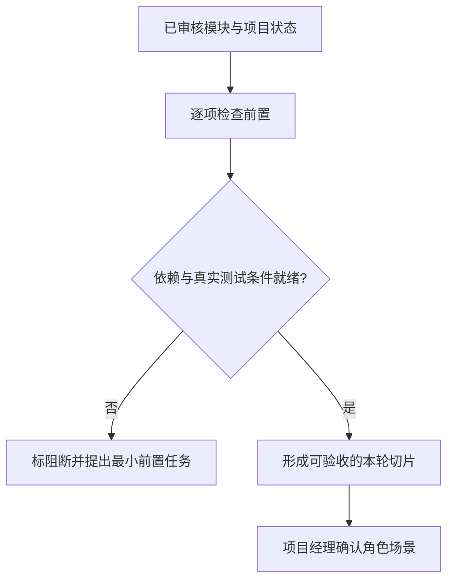

# 本轮模块选择与依赖检查

## 1. 工作目标与输入

判断现在先做哪个模块最能形成完整业务切片、又不被尚未完成的上游依赖卡死。

- `docs/output/05-模块拆分/项目模块清单.md`
- `docs/output/05-模块拆分/模块依赖关系.md`
- `docs/output/04-开发环境/开发环境部署与验收.md`
- `docs/output/项目总控/项目实施状态.md`（首次不存在时初始化）

## 2. 具体操作

1. 读取模块池、业务依赖与实施状态；所有模块的初始状态统一为未开始，不因为PRD存在就称已设计或完成。
2. 逐模块核对真正前置依赖：项目ID、字典、模板、身份权限、外部接口、数据库域、环境连接，区分可以用稳定契约并行和必须等前置数据落库的任务。
3. 选择1个或多个可独立验收的模块；明确本轮用户角色、核心业务场景、实际页面/后端范围、验收条件与不做事项。
4. 若存在第三方阻塞，给出可在本轮完成的前置任务或推迟模块；模拟验证只能标成技术模拟，不能当真实对接完成。
5. 项目经理确认本轮业务目标，开发人员确认环境及前置能力真实可用；只为已选模块进入Grill/详细设计和to-spec。

## 3. 审核与失败路径

**关卡**：模块有可测试的纵向切片且前置依赖、测试环境和验收人到位时才能开始本轮。

输入资料并不自动等于事实已确认，实际程序运行没有命令与输出不能填“已通过”；所有技术建议均以本项目已确认基线和PRD为准。

## 4. 交付文件

- `docs/output/06-模块迭代/本轮模块计划.md`
- `docs/output/06-模块迭代/前置依赖检查.md`

## 5. 支持文件

- [专属审核标准](references/execution-gate.md)
- [交付模板](assets/output-template.md)
- [报价系统场景示例](examples/报价项目场景示例.md)

## 迭代选择的解锁算法

每个候选模块必须列出：上游模块实际状态、角色/字典/基础数据、第三方环境、数据库域、既有页面和测试人员；不可把“接口计划已定”当作“真实接口已可用”。项目实施状态唯一保存 `docs/output/项目总控/项目实施状态.md`（首次没有则创建），本轮只选择能产生可演示业务结果的模块；输出 `docs/output/06-模块迭代/本轮模块计划.md` 和 `docs/output/06-模块迭代/前置依赖检查.md`。不在此生成全模块Spec。
