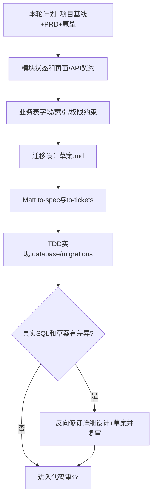

# 本轮模块详细设计

## 目标

形成真实可开发、可测试、可审查的模块设计，而不是摘要或空模板。必须遍历 `docs/input/` 下与本轮模块有关的全部原始资料（需求、工程、环境、对接及新增类别），并读取 `docs/output/06-模块迭代/本轮模块计划.md`、已批准的 `docs/output/02-整体架构/整体架构设计.md` 的组件清单/交互矩阵、工程代码复用与依赖约束、A/B/C冻结清单、项目基线、数据库总体和模块依赖。实际检查已有 `code/` 原型页面与 `code/` 业务扩展点，继承 GLOSSARY/ADR。**整体架构已批准的组件/运行单元、代码接口、关键业务链路主要处理顺序、Worker归属、权限、数据与状态Owner，以及S05已批准的核心表/字段、ER关系和数据规则，都是本轮必须继承的骨架。** 要读取S04核心业务链路目录及本模块相关处理流程；不能因方便实现而删掉告警规则判断、持久化、通知可靠交接、审批分支或改成另一套Owner。真正需要改变关键架构步骤，先返回S04经技术总监审核后再细化。

## 实现流程

0. **内部Grill澄清未决模块决策（按需）**：先按已经确认的PRD和整体组件/交互骨架识别哪些关键业务语义、模块接口、异常状态或外部接口仍无确定答案。如果存在阻断设计的高代价疑点，**本Skill内部调用** `grill-with-docs`（`skills/grill-with-docs/SKILL.md`），由官方grilling逐轮给推荐并等待答复、domain-modeling必要时更新术语/ADR。没有真实未决问题则跳过，不能为了Grill重复问已经确定的PRD。若用户提议更换总体运行单元或Worker通信协议，应暂停模块设计，返回architecture-baseline技术总监审核。
1. **在已定架构组件与关键业务处理链路内定位模块边界**：从总体架构组件清单/交互矩阵和工程约束找到本模块在现有前后端代码中的具体扩展位置、主责组件、可复用公共能力与允许依赖，锁定本轮模块负责的核心业务对象、用户角色、页面入口、上游数据和下游消费者，拒绝扩大到未排入本轮的模块。
2. **在既定状态权威下设计业务规则与状态**：不能让模块私自另建第二套编排或业务状态Owner；按模块PRD建立成功、失败、重试、取消、驳回/重提等真实状态迁移；写清权限、谁触发、幂等、并发冲突、版本可追溯。关键对象应有状态表或状态图，不用大段叙述掩盖分支。
3. **对齐已有页面**：给出页面→业务动作→接口→后端服务映射；先定位原型现有组件/样式与既有后端公共能力，只做接入和必要局部更改，禁止另建同功能页面。
4. **继承S05核心数据骨架并完成模块数据详细设计**：逐一核对数据库总体中的整体规则、关键数据生命周期、核心表/字段契约、核心ER关联、Owner与A/B/C冻结项；引用真实核心表和字段名而不另建同义主表或修改身份/状态/版本语义。在此基础上仅为当前模块补充非核心字段、内部辅助表、完整类型/约束、索引、逻辑外键、权限过滤、幂等和迁移设计草案。**若需要更改已锁定的跨模块关键字段、关联或Owner，先返回S05重审；同时影响组件/关键业务链路时必须先返回S04。**TDD阶段生成实际版本化SQL，偏离草案需反向修订并审核。
5. **细化已批准组件交互下的API契约**：不得把总体批准的REST/gRPC/iframe集成任意替换；每个业务动作列 HTTP方法/路径、角色/权限、参数结构、成功响应、业务错误码、事务边界、分页过滤与重复请求处理；跨模块接口应有生产者/消费者和兼容性说明。
6. **风险与质量验证**：将已确定的工程基线（例如CPU/内存、并发、保留年限、P95）逐条落实到设计约束；选择最高可用的测试接缝，优先复用已有接口/服务边界，交 `to-spec`。
7. **骨架一致性与设计审查**：核对每个接口属于已批准组件交互，每个数据Owner和部署边界延用整体架构；调用 [模块设计门禁](references/module-design-gate.md)。设计涉及A级工程组织、总体权限、数据Owner、跨组件协议或系统部署改变时停止并提请技术总监返回S04重新评审；B级兼容例外必须审批，不得在模块设计中私自改变整体基线。

## 交付

输出中须引用所遵守的总体架构组件ID、组件关系“发起方→接收方+协议/场景”和A/B/C冻结条目，不得伪造交互ID；模块详细设计**填充骨架但不改动骨架**，必要时经技术总监批准后先升级总体架构再同步模块设计。

- `docs/output/06-模块迭代/<模块>/模块详细设计.md`
- `docs/output/06-模块迭代/<模块>/迁移设计草案.md`（开发阶段才形成`database/migrations/`版本化SQL）
- 必要新ADR沿用 `docs/adr/` 编号。

使用 [模板](assets/module-design-template.md)。模块详细设计是整个项目最深一级设计，**只深化本轮模块**。

## 从设计到真正可执行的迁移脚本

**模块设计不能代替Spec，也不能让Spec重问需求**：设计约定“业务如何在现有代码中运转”，Spec汇总为可开发的角色场景和测试约束。若改变全局资源/部署/数据域先交技术总监。迁移设计草案必须写目标表/列、变更顺序、数据兼容、回滚风险及验收方案；实现阶段再生成版本化SQL并验证。
