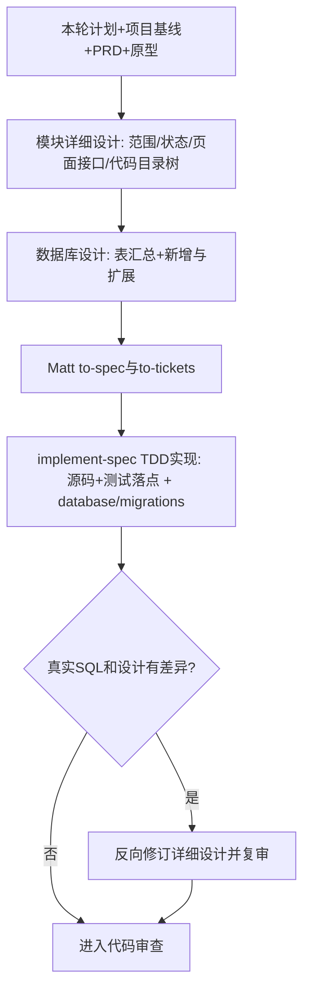

# 本轮模块选择、依赖检查与详细设计

## 目标

形成真实可开发、可测试、可审查的模块设计，而不是摘要或空模板。必须遍历 `docs/input/` 下与本轮模块有关的全部原始资料（需求、工程、环境、对接及新增类别），并读取 `.scratch/<module_key>/模块详细设计.md`（本模块当前有效设计）、已批准的 `docs/output/02-整体架构/整体架构设计.md` 的组件清单/交互矩阵、工程代码复用与依赖约束、架构冻结清单、项目基线、数据库总体和模块依赖。实际检查已有 `code/` 原型页面与 `code/` 业务扩展点，继承 GLOSSARY/ADR。**整体架构已批准的组件/运行单元、代码接口、关键业务链路主要处理顺序、Worker归属、权限、数据与状态Owner，以及数据库总体设计已批准的核心表/字段、ER关系和数据规则，都是本轮必须继承的骨架。** 要读取整体架构设计的核心业务链路目录及本模块相关处理流程；不能因方便实现而删掉告警规则判断、持久化、通知可靠交接、审批分支或改成另一套Owner。真正需要改变关键架构步骤，先返回整体架构设计经技术总监审核后再细化。

## 本轮任务选择及依赖门禁

1. 从已审核模块清单、模块依赖图和项目实际状态确定本轮模块及**独立开发任务**。区分首次开发、同一任务继续、已验收后新增需求；新任务生成新Spec，已完成Spec/Tickets不覆盖。
2. 首次进入本阶段时按审核模块池初始化`docs/output/项目总控/项目实施状态.md`；**每个模块只在首次进入本阶段时更新一次**（模块进入级，只登记该模块的进入/阻塞/任务引用），此后模块内进度一律到 `.scratch/<module_key>/` 查看，不在总控逐任务维护。已有时必须保留历史验收与任务引用，不重新初始化。
3. 检查上游模块、数据身份/写入方、权限/字典/基础数据、现有前后端代码、第三方真实接口与测试环境，并核实开发前置条件（数据库可否连接、本模块用到的中间件、第三方凭据及其获取步骤、种子数据、可编译启动）。明确已就绪、稳定契约可并行、真实阻塞，Mock仅为技术模拟，不能算真实业务通过。
4. 将任务角色×核心场景、页面/后端范围、非目标、责任人、真实依赖证据、开发前置条件与最小解锁工作写入 `模块详细设计.md` 第 1 章（1.4 依赖与开发前置条件自检）；项目经理确认业务范围，开发人员确认依赖与前置条件。
5. 依赖不可解锁则暂停相关范围，不进入to-spec；通过后继续以下详细设计。模块详细设计作为**最新有效设计**增量更新，但不修改已完成任务的历史Spec和验收记录。

## 实现流程

0. **内部Grill澄清未决模块决策（按需）**：先按已经确认的PRD和整体组件/交互骨架识别哪些关键业务语义、模块接口、异常状态或外部接口仍无确定答案。如果存在阻断设计的高代价疑点，**本Skill内部调用** `grill-with-docs`（`skills/grill-with-docs/SKILL.md`），由官方grilling逐轮给推荐并等待答复、domain-modeling必要时更新术语/ADR。没有真实未决问题则跳过，不能为了Grill重复问已经确定的PRD。若用户提议更换总体运行单元或Worker通信协议，应暂停模块设计，返回architecture-baseline技术总监审核。
1. **在已定架构组件与关键业务处理链路内定位模块边界**：从总体架构组件清单/交互矩阵和工程约束找到本模块在现有前后端代码中的具体扩展位置、主责组件、可复用公共能力与允许依赖，锁定本轮模块负责的核心业务对象、用户角色、页面入口、上游数据和下游消费者，拒绝扩大到未排入本轮的模块。写入 `模块详细设计.md` 第 1 章。
2. **在既定状态权威下设计业务规则与状态**：不能让模块私自另建第二套编排或业务状态Owner；按模块PRD建立成功、失败、重试、取消、驳回/重提等真实状态迁移；写清权限、谁触发、幂等、并发冲突、版本可追溯。关键对象应有状态表或状态图，不用大段叙述掩盖分支。写入第 2 章。
3. **对齐已有页面并写全接口**：**按页面**组织接口（接口名称、业务动作、请求参数、返回响应、示例）；先定位原型现有组件/样式与既有后端公共能力，已有接口**只做表格汇总**，新增接口逐项写全；给出页面→业务动作→接口→后端服务映射，只做接入和必要局部更改，禁止另建同功能页面。写入第 3 章。
4. **继承数据库总体设计的核心数据骨架并完成模块数据详细设计**：逐一核对数据库总体中的整体规则、关键数据生命周期、核心表/字段契约、核心ER关联、写入方与架构冻结项；引用真实核心表和字段名而不另建同义主表或修改身份/状态/版本语义。先出**表汇总**（标注复用/新增/扩展），再对新增与扩展逐列（类型/约束/索引/引用/幂等）写全并带表名，写入第 4 章。**若需要更改已锁定的跨模块关键字段、关联或写入方，先返回数据库总体设计重审；同时影响组件/关键业务链路时必须先返回整体架构设计。**编码阶段生成实际版本化 SQL；如与设计有差异须反向修订本设计并复审。
5. **画出本阶段代码目录树**：给出本轮新增/改动的**源码目录与文件**，并给出后续 `/implement-spec`（走 `tdd`）实现本轮 tickets 时**测试文件的落点**——测试只写在接缝处，落点须与第 6 章的测试接缝一一对应；两者逐项带中文注释，标明复用点与扩展点。项目尚无测试框架时，在此写明需引入的最小测试依赖与运行命令。写入第 5 章。
6. **风险与质量验证**：将已确定的工程基线（例如CPU/内存、并发、保留年限、P95）逐条落实到设计约束；选择最高可用的测试接缝，优先复用已有接口/服务边界，写入第 6 章，交 `to-spec`。并在第 7 章写清验收标准。
7. **骨架一致性与设计审查**：核对每个接口属于已批准组件交互，每个数据写入方和部署边界延用整体架构；调用 [模块设计门禁](references/module-design-gate.md)。设计涉及工程组织、总体权限、数据写入方、跨组件协议或系统部署改变时停止并提请技术总监返回总体架构重新评审；兼容例外必须审批，不得在模块设计中私自改变整体基线。

## 交付

输出中须以**名称**表述所继承的组件与交互（"发起方→接收方+协议/场景"），不得伪造交互；模块详细设计**填充骨架但不改动骨架**，必要时经技术总监批准后先升级总体架构再同步模块设计。

- `.scratch/<module_key>/模块详细设计.md`（长期维护当前有效设计；Spec 的真实位置由已配置 Tracker 决定，不强迫与此文件同目录；第 1 章含本轮任务范围与依赖，**不再单独出"本轮范围与依赖检查"文档**；章节目录见模板）
- `docs/output/项目总控/项目实施状态.md`（**每个模块首次进入本阶段时更新一次**，只登记模块进入级状态；模块内进度到模块目录查看）
- 必要新ADR沿用 `docs/adr/` 编号。

使用 [模板](assets/module-design-template.md)。模块详细设计是整个项目最深一级设计，**只深化本轮模块**，固定七章：

1. 本轮任务范围与依赖（已有能力与继承边界／本轮开发范围／非目标／依赖与开发前置条件自检）
2. 业务流程和状态
3. 接口清单（按页面划分；**已有接口可不重复展开字段，但必须引用已核实的契约或实际测试证据并检查当前动作的字段/权限/错误语义适配**；新增接口用**加粗接口名**给出方法路径、请求与响应字段表（必填/选填、类型、中文解释）与示例）
4. 数据库设计（**表汇总**给出每张表的中文名与作用并标注复用/新增/扩展；**新增与扩展**每张表写中文名与作用后逐列写全）
5. 本阶段代码目录树（源码落点 ＋ `/implement-spec` 的 TDD 测试落点，带中文注释；测试落点对应第 6 章接缝）
6. 性能资源与测试接缝
7. 验收标准

## 从设计到真正可执行的迁移脚本

**模块设计不能代替Spec，也不能让Spec重问需求**：设计约定"业务如何在现有代码中运转"，Spec汇总为可开发的角色场景和测试约束。若改变全局资源/部署/数据域先交技术总监。数据库变更在编码阶段直接由《模块详细设计》第 4 章生成版本化 SQL；如与设计有差异须反向修订设计并复审。

## 稳定任务映射与设计版本契约（F13/F14/F15）

- 使用 S07 的稳定 `module_key` 记录任务关联，维护 `module_key → 本轮任务ID → 已配置 Issue Tracker 的URL/本地feature-slug目录 → Spec/签收证据` 映射。**不改 Matt 原版 Tracker 的 `.scratch/<feature-slug>/spec.md`/`issues/` 规则**；GitHub/GitLab用真实Issue URL和提交引用，不能假定 `.scratch/<module_key>/<任务>/` 一定存在。
- 每次生成 Spec 之前记录当前《模块详细设计》的 Git Commit SHA 或不可变设计快照引用，并让本轮 Spec/Ticket 指向该修订。设计文件后续更新不得覆盖旧任务的设计依据；上游A/B级冻结项变化时明确影响哪些已有任务及需否重测。
- 已有接口只可省略重复字段表，不能省略契约核查。对照当前操作的请求/响应字段、租户/角色权限过滤、状态与错误语义、幂等/分页要求；不足处列为接口改造项。
