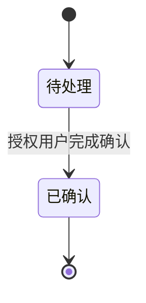

# <模块>详细设计

> 稳定module_key：<slug>；当前设计修订：<Git SHA/不可变快照引用>；关联任务/Tracker：<Issue URL或feature-slug>。此文件长期维护模块当前有效设计，不覆盖此前独立Spec与签收历史。固定七章；只深化本轮模块。标题不带括号注释。
>
> 引用约定：用**名称/主题**表述继承来源与约束，正文不引用上游的章节号、条目号、级别标号或其它模块编号；不伪造交互。

## 1. 本轮任务范围与依赖

### 1.1 已有能力与继承边界

| 组件/能力 | 本模块职责、真实代码落点与复用 | 与其它组件的交互（发起方→接收方，协议/场景） | 不可修改的冻结约束 |
|---|---|---|---|

> 另记：复用的既有代码/服务/表，以及与上游模块（用模块名）的既有契约现状。

### 1.2 本轮开发范围

| 任务标识/类型 | 角色×场景 | 页面/后端范围 | 业务结果 |
|---|---|---|---|

### 1.3 非目标

| 不做的事项 | 归属模块/后续轮次 | 原因 |
|---|---|---|

### 1.4 依赖与开发前置条件自检

> 设计完成即开工，逐项核实「是否有条件开工」。**未具备的写出获取步骤**，不假定已具备。

| 依赖/前置项 | 所需内容 | 现状 | 分类 | 缺失时的获取步骤或替代方案 | 责任人 |
|---|---|---|---|---|---|
| 数据库 | 目标库可连接、可建表 | | | | |
| 中间件 | 本模块用到的缓存/消息等可用 | | | | |
| 第三方凭据 | 本模块用到的第三方（账号/密钥/签名/模板码） | | | | |
| 基础数据/种子 | 登录与权限所需租户、超管账号、菜单等 | | | | |
| 上游契约 | 依赖的上游模块接口就绪或已冻结 | | | | |
| 代码与环境 | 前后端工程可编译/可启动 | | | | |

> 项目经理确认业务范围、开发人员确认依赖与前置条件后，方可进入 `to-spec`。

## 2. 业务流程和状态



| 当前状态 | 事件/操作者 | 前提 | 下个状态 | 失败处理 | 权限 | 幂等/并发 | 版本/追溯 |
|---|---|---|---|---|---|---|---|

> 每个核心业务对象一张状态图；分支、失败、重试、取消/驳回在表里写清；权限、幂等、并发冲突、版本可追溯一并写明。

## 3. 接口清单

> 按页面划分。每个页面一个三级小节，标题只写页面名，序号自 3.1 起连续编号（3.1、3.2…）。**已有接口**可不展开完整DTO，但须列现有契约引用、字段/权限/错误语义适配结论和待改造项；**新增接口**在表下用**加粗接口名**给出方法路径、请求字段、响应字段与示例。列名可按需调整。

### 3.1 <页面名>

路径：`<路由>`

| 接口名称 | 业务动作 | 方法路径 | 已有/新增 | 权限 | 分页/幂等/错误码 | 现有契约/适配证据 |
|---|---|---|---|---|---|

**<新增接口名> `<方法> <路径>`**

请求字段

| 字段 | 必填/选填 | 类型 | 中文解释 |
|---|---|---|---|

响应字段

| 字段 | 类型 | 中文解释 |
|---|---|---|

示例

```json
// 请求 <方法> <路径>
{ "<字段>": "<值>" }
// 响应
{ "code": 0, "msg": "操作成功", "data": { } }
```

## 4. 数据库设计

### 4.1 表汇总

> 逐表给出**中文名**与**作用**，并标注每张表是**复用/新增/扩展**。列名可按需调整。

| 表名 | 中文名 | 作用 | 复用/新增/扩展 | 写入方 | 本模块读写方式 |
|---|---|---|---|---|---|

### 4.2 新增与扩展

> 每张表用**加粗的表名+中文名**起头，先写该表的**作用**，再逐列写字段（新增表列全，扩展表列新增列）。

**表名 中文名**

作用：一句话说明。

| 字段名 | MySQL类型 | 必填/默认 | 索引/唯一/引用 | 中文解释 |
|---|---|---|---|---|

> 只补非核心字段、辅助表、索引、逻辑引用、权限过滤、幂等；不改已锁定的跨模块关键字段/关联/写入方（需要则先回数据库总体设计）。

## 5. 本阶段代码目录树

> 同时给出**源码落点**与**测试落点**。测试落点是后续 `/implement-spec`（走 `tdd`）实现本轮 tickets 时测试文件的目录，测试只写在接缝处，故每个测试落点须对应第 6 章的一个测试接缝。只列本轮新增/改动的目录与文件，不铺开无关目录；项目尚无测试框架时，另行写明需引入的最小测试依赖与运行命令。

```text
code/
├── <后端工程>/                      # <中文注释：本轮涉及的后端工程>
│   ├── <模块>/src/main/...          # 源码：<中文注释：新增/复用点>
│   └── <模块>/src/test/...          # 测试（TDD 落点）：<对应接缝，如 API/服务级>
└── <前端工程>/src/
    ├── api/                         # 源码：<中文注释>
    ├── views/<页面>/                # 源码：<中文注释>
    └── <测试目录>                   # 测试（TDD 落点）：<对应接缝，如 UI/请求封装>
```

| 落点 | 目录或文件 | 新增/复用/扩展 | 对应第 6 章测试接缝 |
|---|---|---|---|

## 6. 性能资源与测试接缝

| 工程基线要求 | 在本模块中如何满足 | 测试验证方法 |
|---|---|---|

> 选择最高可用的测试接缝（API/服务级/UI），优先复用已有接口/服务边界；测试文件的目录落点见第 5 章。交 `to-spec`，并作为后续 `/implement-spec`（`tdd`）的测试接缝。

## 7. 验收标准

| 模块业务场景 | 角色 | 前置条件 | 角色任务/操作路径 | 预期业务结果 | 关键异常/回退 |
|---|---|---|---|---|---|

## 设计修订与历史任务引用（流程性元数据）

| module_key | 本轮任务/Tracker URL 或本地feature-slug | Spec 位置 | 设计基准Commit/快照 | 变更影响（如有） |
|---|---|---|---|---|
| | | | | |

> 后续设计更新不追溯改写历史Spec验收依据；检查已有接口必须引用真实契约证据。
