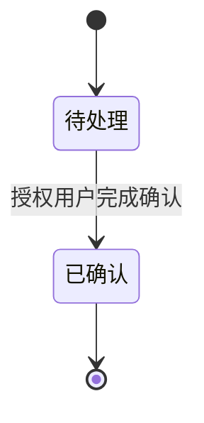

# <模块>详细设计

## 1. 范围与角色场景

| PRD业务场景 | 涉及页面（原型路径） | 业务结果 | 非目标 |
|---|---|---|---|

## 2. 业务对象和状态

| 当前状态 | 事件/操作者 | 前提 | 下个状态 | 失败处理 |
|---|---|---|---|---|

## 3. 页面动作到服务的映射

| 既有Vue页面/组件 | 业务动作 | REST接口 | 若依业务模块 | 权限 |
|---|---|---|---|---|

## 4. 数据库具体设计

| 表 | 字段名 | MySQL类型 | 必填/默认 | 索引/唯一/引用关系 | 业务含义 |
|---|---|---|---|---|---|

## 5. API及业务错误

| 方法/路径 | 调用角色 | 请求关键参数 | 响应内容 | 业务异常/幂等规则 |
|---|---|---|---|---|

## 6. 事务、一致性、版本与权限

| 场景 | 事务和幂等 | 数据版本 | 权限/审计 |
|---|---|---|---|

## 7. 性能资源与测试接缝

| 工程基线要求 | 在本模块中如何满足 | 测试验证方法 |
|---|---|---|

## 8. 数据库迁移与兼容

| 迁移步骤 | SQL路径或对象 | 影响 | 备份/回退边界 |
|---|---|---|---|

## 9. 模块设计审查结论

| 审查点 | 证据 | 通过/退回 |
|---|---|---|
