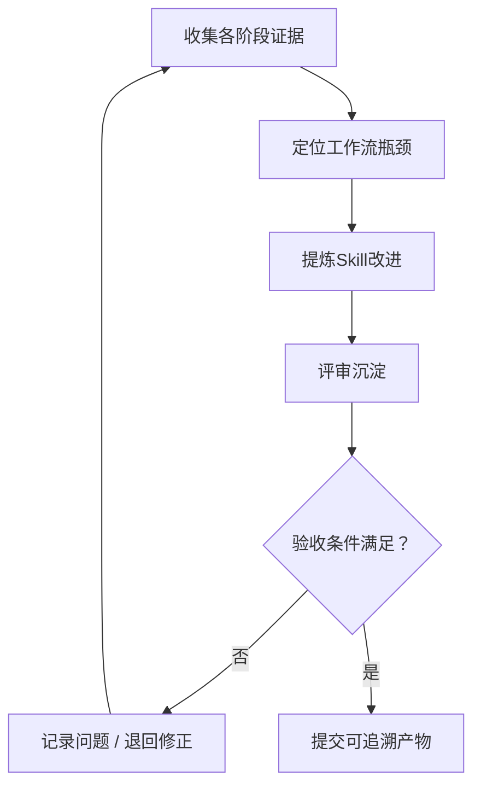

# 复盘完整研发流程并沉淀 Skill 改进

> 类型：基于Matt改造  
> 参考：mattpocock/skills / skills/engineering/retro/SKILL.md  
> 来源：[GitHub 源文件](https://github.com/mattpocock/skills/blob/main/skills/engineering/retro/SKILL.md)  
> 本文是针对项目场景的原创实现说明，并非上游 Skill 原文。

## 一、职责与边界

本 Skill 只负责「复盘完整研发流程并沉淀 Skill 改进」，从确定的输入形成可审核输出，不越权替代其他步骤。  
项目原型基线是 `code/fld/`；后端框架是 `code/guiwu_ruoyi/`。PRD 位于 `docs/input/需求资料/`，其他可选输入位于 `docs/input/工程资料/`、`docs/input/环境资料/`、`docs/input/对接资料/`。不重做已确认PRD，不独立设计另一套前端视觉与交互体系。Git提交说明使用中文。

## 二、触发条件

当前研发工作流执行到「复盘完整研发流程并沉淀 Skill 改进」，且存在所需输入或已记录的阻塞项时调用。无权访问或无法验证时明确给出阻塞状态，不虚构结果。

## 三、输入

- `各阶段审核记录`
- `每轮模块计划与验收`
- `AI开发会话复盘.md`
- `上线交付记录`

## 四、执行流程

### 执行准则

1. **收集各阶段证据**：读取对应上下文和实际证据，检查与前序项目基线的关系，记录决定和异常。
2. **定位工作流瓶颈**：读取对应上下文和实际证据，检查与前序项目基线的关系，记录决定和异常。
3. **提炼Skill改进**：读取对应上下文和实际证据，检查与前序项目基线的关系，记录决定和异常。
4. **评审沉淀**：读取对应上下文和实际证据，检查与前序项目基线的关系，记录决定和异常。

与Matt retro会话复盘区分：本步骤聚焦整项目的研发阶段、审批、Skills粒度和返工效率。

## 五、输出

- `docs/output/09-复盘/研发流程复盘.md`
- `docs/output/09-复盘/Skill优化清单.md`
- `待确认的工作流变更建议`

## 六、验收与中止条件

技术总监确认流程调整优先级；项目经理核实业务沟通成本；改进不直接覆盖已审核基线。

若输入文档不支持技术结论、第三方接口未确认、实测环境不可达，应输出待确认项并中止受阻部分。产出必须与本项目的PRD、源码和工程基线一致。

## 七、示例和模板

- [使用示例](./examples/使用示例.md)
- [输出模板](./templates/输出模板.md)

## 八、参考与差异

参考项目：mattpocock/skills（[源文件](https://github.com/mattpocock/skills/blob/main/skills/engineering/retro/SKILL.md)）。参考其领域与接口设计方法；本技能额外增加报价项目目录、前端原型守护、角色审核及可追溯产物要求。