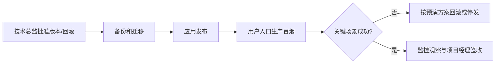

# 应用首次上线与版本更新（开发/测试/正式）

## 1. 职责和输入

按环境及操作类型执行经批准的应用部署，逐项记录构建、数据库迁移、冒烟和交接。开发/测试可在模块迭代期间按需要发布应用，但正式环境必须经业务验收、系统质量验收和预演放行；没有对应环境权限不得宣称部署完成。

- 实际目标环境（开发/测试/正式）、发布类型（首次应用上线/版本更新）及经确认的部署配置和操作授权
- `docs/output/08-上线交付/部署预演.md`、`备份回滚方案.md` 与待发布构建/迁移摘要
- 正式环境须有 `docs/output/07-系统验收/系统验收报告.md` 与 `上线评审结论.md` 的有效签收及版本指纹

## 2. 执行与验证

1. 首先标明环境（开发/测试/正式）和首次/更新类型，并核对对应的 release_fingerprint（Git Commit、前端digest、后端镜像digest、迁移checksum集合、配置摘要）、操作授权及备份/操作窗口；环境或版本变化不能复用旧批准结论。
2. 按照批准的预演方案在对应目标环境真实发布：首次应用上线核实依赖服务/首建初始化/应用入口；更新先核旧版本、业务兼容、迁移和可回退点；逐项记录实际命令、版本、退出码，不覆盖未知运行库或不同环境的卷。
3. 从本次环境的真实访问或事件入口按当前PRD检查登录、关键业务、授权、数据状态与实际第三方连接，记录冒烟证据；开发/测试冒烟不等于正式生产验收。
4. 部署后观察真实资源、日志、队列/任务、数据库连接和关键业务错误，出现阻塞异常按经批准的回滚/前向修复路径执行。
5. 整理可运行版本、备份恢复路径、日志排障、运维联系人、用户验收和交付文档，分别由开发人员、技术总监、项目经理作职责内确认。

## 3. 审核关卡与失败后回退

真实指定环境部署有命令/日志/版本/核心业务结果及交接证据；开发/测试的成功不能冒充生产上线，预演也不能替代真实部署。正式发布必须有项目经理与技术总监对应放行。

每一项状态必须基于实际文件、真实测试记录、当前代码及环境；没有可执行环境或缺少授权时必须给出阻塞结论，不得编造完成记录。涉及Git提交均使用中文提交说明。

## 4. 正式产物

- `docs/output/08-上线交付/上线记录.md`
- `docs/output/08-上线交付/交付清单.md`

## 5. 配套材料

- [独立检查门禁](references/execution-gate.md)
- [交付模板](assets/output-template.md)

## 生产部署的真实执行链

发布记录必须写真实时间、操作者、镜像摘要/Commit、迁移版本、健康检测、跨系统接口状态及回滚判断。客户服务器不可访问或未授权则只提供操作计划和待执行项，不写“上线成功”。交付物按 `上线记录.md`、`交付清单.md`、运行环境/备份/日志及运维联系人逐项签收。

**统一发布指纹（F06）**：从系统验收至上线评审、部署预演、正式上线以不可变 `release_fingerprint = Git Commit + 前端产物digest + 后端镜像digest + 数据库迁移文件checksum集合 + 配置基线摘要（不含密钥）` 关联证据与审批编号，另列实际环境版本。Tag仅展示用途，不替代 digest。任一构件、SQL或配置变化，旧证据不得自动沿用；先做影响分析，至少重跑受影响的业务验收、性能/安全及部署回滚预演，并重新审批。

**发布前强制比对**：对照当前拟部署文件逐字核查 S16业务验收、S17非功能审批、S18预演及S19待上线的统一指纹；任一组件/迁移/配置摘要不匹配立即停止，明确影响评估并返回对应关卡取得新批准；严禁仅因 tag 一致就放行。

## 实际执行的四种场景

| 环境 | 首次应用上线 | 已有版本更新 |
|---|---|---|
| 开发 | 在S06基础组件之上发布首个应用构建，核对本地配置和入口 | 检查开发版变更、迁移、基本回归、回退点 |
| 测试 | 使用隔离的测试配置和数据库首次部署应用，形成真实联调入口 | 使用测试数据演练升级、回归、迁移和失败恢复 |
| 正式 | **S16+S17批准后**首建应用和正式入口，谨慎处理既有数据 | **S16+S17受影响场景重验后**按变更/备份/回滚窗口升级现网 |

每次必须明确环境名称、旧→新版本、首次/更新类型、责任人、授权、命令与真实结果。正式环境发现阻断故障按已批准路径回滚或前向修复；严禁未经授权在生产权威库执行恢复/破坏性命令。Git提交说明使用中文。
