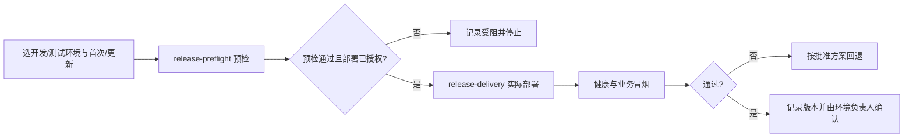

# 上线部署：开发环境和测试环境

## 1. 范围与执行分支

本 Skill 是导航中 S18「上线部署」的主入口。仅有**两类目标环境 × 两类发布操作**：

| 环境 | 首次应用上线 | 版本更新 |
|---|---|---|
| 开发环境 | 在 S06 基础设施上部署首个应用版本并验证开发入口 | 保留现有开发数据，部署新版本并回归/回退核验 |
| 测试环境 | 按测试专属配置独立部署应用，验证测试入口 | 备份现有测试数据，增量迁移并复测关键场景 |

每次只选择上表中一种情况执行。部署场景以实际项目 PRD 与当前代码为依据，不预设报价、审批、IoT 或 Agent 项目特定流程。S06 仅部署基础设施、数据库与中间件，本步骤负责应用首次上线和后续更新。

## 2. 输入与部署前的强制门禁

- 目标开发/测试环境的专属部署配置、服务器/权限和已有服务；
- 当前版本（首次应用上线时为首次发布说明）、目标 Git Commit、镜像/构建摘要、必要数据库迁移；
- 若更新，必须读取上个版本、当前数据/附件、备份、回滚策略及受影响的业务场景；
- 实际操作人、环境负责人、执行授权及具体允许的操作范围。

**先调用** [release-preflight](../release-preflight/SKILL.md)：核对环境隔离、构件、迁移、数据备份、隔离恢复与回退预演。未取得该环境的预检放行证据和操作授权，不得继续应用发布；不要把预演成功写成实际上线成功。

## 3. 执行与验证

1. 核对选定的开发或测试环境、首次/更新类型、发布指纹（Git Commit、构建/镜像 digest、数据库迁移 checksum、脱敏配置摘要）、预检结果与授权范围。
2. 按批准顺序在**同一个指定环境**部署应用与必要 SQL。首次上线检查依赖和初次启动，版本更新检查旧→新版本及兼容/数据连续性。记录执行命令、退出码和真实版本；不得覆盖另一环境的配置、端口、数据卷或数据库。
3. 在该环境真实访问入口执行认证、健康检查和当前 PRD 定义的关键业务冒烟，保留请求、响应、日志及必要外部连通证据。
4. 检查真实资源、应用日志、队列、数据库连接、后台任务等。阻断故障按已批准的回滚或前向修复方案处理；危险操作须**单独授权**。
5. 记录环境名称、首次/更新类型、旧版→新版、发布指纹、实际执行人、验证与交接结果。开发环境的成功不能替代测试环境验收，反之亦然。

## 4. 审核和回退

开发人员负责真实操作与证据；对应开发或测试环境负责人核对预检、授权、执行与冒烟结果。**未执行、失败或受阻不能判定部署成功**。发布指纹发生变化，按影响范围重新执行必要预检和验证。Git 提交说明均使用中文。

## 5. 输出

- `docs/output/08-上线交付/部署预演.md`（前置 `release-preflight`）
- `docs/output/08-上线交付/备份回滚方案.md`（前置 `release-preflight`）
- `docs/output/08-上线交付/上线记录.md`（只在实际部署后生成）
- `docs/output/08-上线交付/交付清单.md`（只在实际交接后生成）

## 6. 配套材料

- [执行门禁](references/execution-gate.md)
- [部署记录模板](assets/output-template.md)
- [输出契约](templates/输出模板.md)

