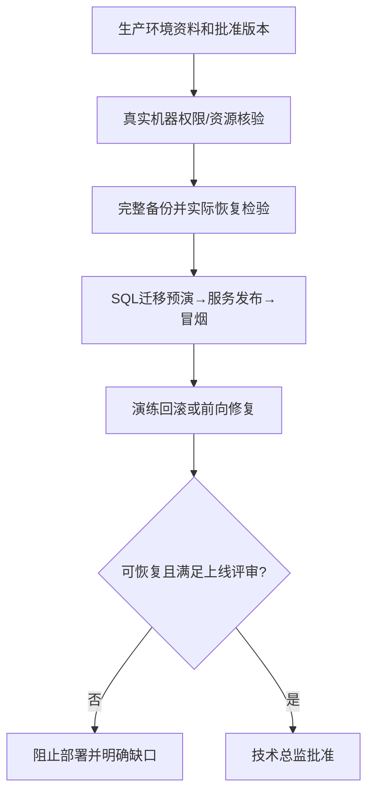

# 按环境与版本类型进行部署预检、备份及回滚预演

## 1. 职责和输入

按目标环境（开发、测试或正式）及发布类型（首次应用上线、已有版本更新），核对实际资源及权限，演练迁移、部署、备份恢复与回滚；未验证恢复路径不能强制上线。开发/测试应用部署按迭代需要进行，无需等待正式系统验收；正式环境必须通过系统业务验收与非功能系统验收。

- `docs/input/环境资料/（目标开发/测试/正式环境）`、`code/deploy/` 的真实部署配置及已存在服务清单
- 本次发布类型（首次应用上线/版本更新）、不可变构建及真实备份/配置、必要迁移脚本
- 正式环境**必须额外读取** `docs/output/07-系统验收/系统验收报告.md` 与 `上线评审结论.md`；开发/测试可先行迭代部署，但不能称生产放行

## 2. 执行与验证

1. 先判定目标环境（开发/测试/正式）、本次操作（首次应用上线/版本更新）以及是否涉及正在使用的数据；现场核实资源、部署目录、Compose命名、网络/端口/卷、数据库、授权及运行服务，不将计划配置当实测事实。
2. 准备不可变版本的前后端构建、SQL迁移清单、配置样例、密钥注入和第三方连通检查；首次应用上线检查初始化依赖和空/既有数据库边界，更新版本检查现网版本、变更清单与兼容性；禁止口令写进仓库。
3. 先制作数据/附件/配置的必要备份，并**在隔离实例/副本的独立 schema 上实际验证能从备份恢复；**严禁以生产权威数据库为恢复目标****；保存可复核命令与结果。
4. 只在已明确隔离范围且已授权的预演环境执行对应的首次部署或增量迁移/应用升级，检查版本、健康、业务冒烟和失败重试。开发/测试环境还需防止与其他环境互相覆盖。
5. 主动演练回滚：停止错误版本、恢复旧镜像/程序、确认数据库回退或前向修复策略与业务当前项目真实存在的历史/审批（如适用）与审计数据不丢失。若不可安全回滚，阻止正式上线并上报。

## 3. 审核关卡与失败后回退

目标环境、操作类型、备份恢复和发布/回滚均有真实执行证据；开发/测试由环境负责人核验，正式环境须有业务与系统质量验收放行、技术总监批准。未获权限只交执行计划，不能写预演成功。

每一项状态必须基于实际文件、真实测试记录、当前代码及环境；没有可执行环境或缺少授权时必须给出阻塞结论，不得编造完成记录。涉及Git提交均使用中文提交说明。

## 4. 正式产物

- `docs/output/08-上线交付/部署预演.md`
- `docs/output/08-上线交付/备份回滚方案.md`

## 5. 配套材料

- [独立检查门禁](references/execution-gate.md)
- [交付模板](assets/output-template.md)

## 发布前的确定性预演

每个脚本以 `版本SHA | 预演环境 | 执行命令 | 返回码 | 迁移前后核对 | 备份可恢复点 | 回滚边界` 存证。不可逆DDL应制定前向修复与阻断策略，不能假称执行 `down.sql` 就可恢复用户数据。开发环境/生产环境隔离，不写客户密码到文档。输出到 `docs/output/08-上线交付/`。

**统一发布指纹（F06）**：从系统验收至上线评审、部署预演、正式上线以不可变 `release_fingerprint = Git Commit + 前端产物digest + 后端镜像digest + 数据库迁移文件checksum集合 + 配置基线摘要（不含密钥）` 关联证据与审批编号，另列实际环境版本。Tag仅展示用途，不替代 digest。任一构件、SQL或配置变化，旧证据不得自动沿用；先做影响分析，至少重跑受影响的业务验收、性能/安全及部署回滚预演，并重新审批。

**生产操作隔离（F19）**：生产上默认只允许授权的只读核查和非破坏性备份，实际恢复、回滚、危险迁移必须在隔离副本/独立实例进行；不得指向生产权威schema。若必须对生产做任何写入/破坏性动作，逐命令展示目标实例、受影响表/卷、停机与恢复方案，取得**针对该次操作的明确授权**；“批准部署配置”不代替该授权。

## 环境与首次/更新两维部署分支

| 目标环境 | 首次应用上线 | 已有版本更新 | 放行依据 |
|---|---|---|---|
| 开发环境 | 核对 S06 已部署基础组件、应用首次运行配置与业务入口 | 核对旧版本、迁移兼容及数据不丢失 | 开发环境配置/执行授权与实际预演 |
| 测试环境 | 独立部署应用和测试依赖，不能复用开发库当测试结果 | 测试数据保护、迁移、回归/恢复预演 | 测试环境负责人授权与实际预演 |
| 正式环境 | 正式域名、权限、初始化或既有数据保护与恢复 | 现网业务连续性、数据库兼容、停机窗口与回滚 | **S16业务验收+S17系统验收、上线批准与逐命令授权** |

**S06 边界**：仅初次部署开发/测试基础设施及中间件；S18/S19 管理应用首次上线/版本更新。部署过程中重建容器、清理卷、修改生产数据库等破坏性操作，必须逐命令核验目标、影响及取得明确授权；恢复演练必须在隔离实例进行。
