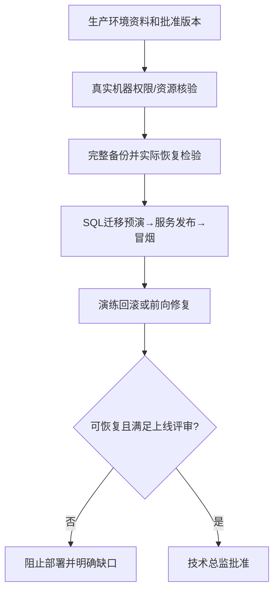

# 生产环境检查与部署回滚预演

## 1. 职责和输入

正式发布前核对目标机实际资源及权限，演练数据库迁移、应用部署、备份恢复和回滚。未验证回滚不可强制上线。

- `docs/input/环境资料/（目标机已确认信息）`
- `docs/output/07-系统验收/上线评审结论.md`
- `交付版本及真实可回滚的数据/配置`

## 2. 执行与验证

1. 在目标生产服务器或已授权的等效环境实际验证CPU/内存/磁盘、操作系统、网络、Docker版本和存储权限；不能把环境资料的计划配置当实测环境事实。
2. 准备不可变版本的前后端构建、SQL迁移清单、配置样例、密钥注入和第三方连通检查；禁止实际口令写进仓库。
3. 先制作数据/附件/配置的必要备份，并**实际验证能从备份恢复**；保存可复核命令与结果。
4. 在独立或经批准的预演环境执行数据库增量脚本和应用发布，检查版本、健康、业务冒烟和失败重试。
5. 主动演练回滚：停止错误版本、恢复旧镜像/程序，并确认数据库安全回退或前向修复后，本项目的关键业务数据、关联关系和历史证据不丢失。无法可靠回滚时阻止上线并说明风险。

## 3. 审核关卡与失败后回退

目标服务器真实确认、备份恢复及发布/回滚有执行证据，技术总监认可；未有服务器权限应给执行计划，不能称预演成功。

每一项状态必须基于实际文件、真实测试记录、当前代码及环境；没有可执行环境或缺少授权时必须给出阻塞结论，不得编造完成记录。涉及Git提交均使用中文提交说明。

## 4. 正式产物

- `docs/output/08-上线交付/部署预演.md`
- `docs/output/08-上线交付/备份回滚方案.md`

## 5. 配套材料

- [独立检查门禁](references/execution-gate.md)
- [交付模板](assets/output-template.md)

## 发布前的确定性预演

每个脚本以 `版本SHA | 预演环境 | 执行命令 | 返回码 | 迁移前后核对 | 备份可恢复点 | 回滚边界` 存证。不可逆DDL应制定前向修复与阻断策略，不能假称执行 `down.sql` 就可恢复用户数据。开发环境/生产环境隔离，不写客户密码到文档。输出到 `docs/output/08-上线交付/`。
