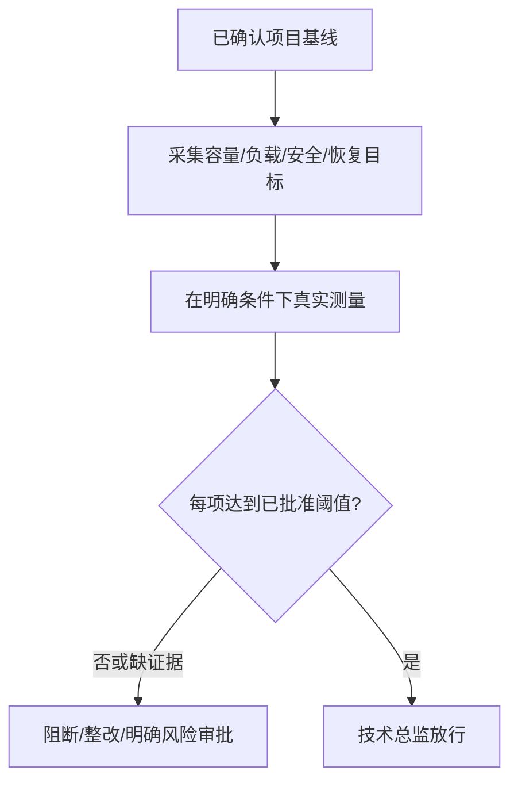

# 上线条件与非功能评审

## 1. 职责和输入

以工程基线已确认的CPU/内存/磁盘预算、负载P95、保留年限、RPO/RTO和安全要求验证上线条件，区分目标、实测与未到位，未经技术总监评审不得进入预演。

- `docs/output/01-项目基线/项目基线.md`
- `docs/output/07-系统验收/系统验收报告.md`
- `当前测试环境及真实运行监控证据`

## 2. 执行与验证

1. 逐项提取项目基线实际批准的用户在线量、HTTP并发、后台任务并发、队列限额与业务P95，列出目标值、测试条件、实测值和证据。
2. 核验基线实际规定的CPU/内存/磁盘、RSS、数据库连接、线程和日志资源阈值；浸泡时长及测试环境严格采用项目批准的数值和测量口径，不默认72小时。
3. 审查服务端数据权限、鉴权、敏感信息脱敏、可观测和审计的关键控制。
4. 对照项目基线检查实际业务数据（如客户资料、设备遥测、任务记录、附件等，按项目适用）的留存/归档/删除起算规则，以及备份恢复实现和RPO/RTO目标；必须有真实恢复证据或如实标受阻。
5. 列明不达标和未测项、建议及发布风险，由技术总监决定退回整改或在有据可查的批准条件下继续。

## 3. 审核关卡与失败后回退

关键业务和基线明确的非功能指标有实测证明、重大安全/数据风险无阻塞；若缺关键测量不能写“上线通过”。

每一项状态必须基于实际文件、真实测试记录、当前代码及环境；没有可执行环境或缺少授权时必须给出阻塞结论，不得编造完成记录。涉及Git提交均使用中文提交说明。

## 4. 正式产物

- `docs/output/07-系统验收/上线评审结论.md`
- `docs/output/07-系统验收/性能安全检查.md`

## 5. 配套材料

- [独立检查门禁](references/execution-gate.md)
- [交付模板](assets/output-template.md)

## 非功能指标：目标、实测与放行

每个非功能项用 `目标值 | 负载/样本条件 | 实测值 | 命令/日志 | 责任人 | 是否达标` 列示，不允许“已优化”替代数据。应交叉核对CPU/内存RSS/磁盘余量、在线人数、HTTP请求并发、长任务并发、P95、保存年限、RPO/RTO及安全权限。**开发机实测不自动等于客户生产机容量验证**。输出 `docs/output/07-系统验收/性能安全检查.md` 和 `docs/output/07-系统验收/上线评审结论.md`。
