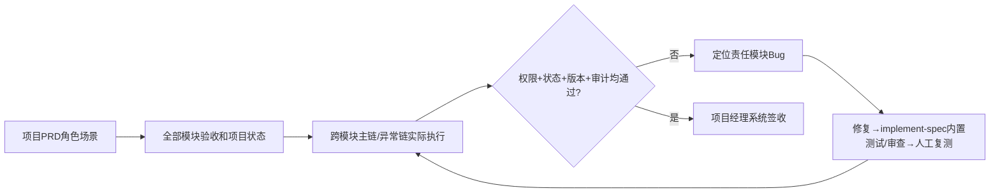

# 项目级端到端业务验收

## 1. 职责和输入

在全部模块人工验收完成后以确认的项目PRD为唯一业务目标，按角色与场景完整执行跨模块业务链、权限和回归，不重复把模块自动测试当成系统业务签收。

- `docs/input/需求资料/（已确认项目PRD与模块PRD）`
- `项目模块实施状态与每轮人工验收`
- `真实可执行的联调环境与必要第三方`

## 2. 执行与验证

1. 根据已批准项目与模块PRD逐个提取角色×核心业务场景，列出主流程、异常分支、权限边界和真实跨模块协作；仅针对本项目确有的功能启用设备采集/告警、审批、长任务、Agent或第三方对接等场景。
2. 从已确认PRD选取每条关键端到端业务链，在真实前端和后台从触发到最终状态逐步验证，追踪主责组件、状态、数据写入与可观察结果；版本、审批、通知、归档等只在项目实际存在时核验。
3. 按真实角色验证登录/业务操作权限、数据域不可越权、重复操作的幂等或业务拒绝结果；无账户系统或不适用的控制明确标不适用并说明依据。
4. 覆盖真实流程中存在的失败、重试、取消、驳回/重提、设备离线、第三方异常等分支，记录实际请求响应、截图、权威状态或外部回执。已由模块验收证实的局部行为只引用证据，重点验证跨模块集成。
5. 项目经理在真实证据基础上逐场景签收；无法使用真实环境的部分标未验收并说明阻塞。

## 3. 审核关卡与失败后回退

所有关键角色场景已有真实执行结果，跨模块主/异常链无阻塞缺陷，项目经理审核同意；否则回到责任模块诊断和复测。

每一项状态必须基于实际文件、真实测试记录、当前代码及环境；没有可执行环境或缺少授权时必须给出阻塞结论，不得编造完成记录。涉及Git提交均使用中文提交说明。

## 4. 正式产物

- `docs/output/07-系统验收/业务场景覆盖矩阵.md`
- `docs/output/07-系统验收/系统验收报告.md`

## 5. 配套材料

- [独立检查门禁](references/execution-gate.md)
- [交付模板](assets/output-template.md)

## 端到端角色业务链的真实判定

把项目PRD中的每个角色×业务场景列成 `场景ID | 角色 | 涉及模块 | 前置数据 | 跨模块操作 | 预期版本/状态 | 真实证据 | 验收人`；主链从已批准的真实业务入口贯穿相关权限校验、权威状态处理和可观察终态；是否包含归档、审批、重提、设备告警或人工确认以项目PRD为准，不能强迫不存在的流程参与验收。报告放在 `docs/output/07-系统验收/`，项目经理签收的是具体真实场景，不是AI生成的虚拟结论。
