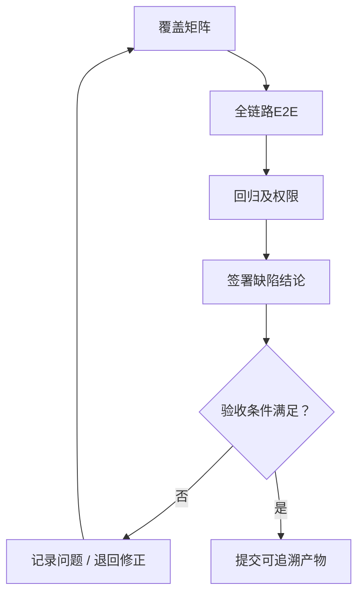

# 全项目业务链路和权限回归

> 类型：自建  
> 参考：obra/superpowers / skills/verification-before-completion/SKILL.md  
> 来源：[GitHub 源文件](https://github.com/obra/superpowers/blob/main/skills/verification-before-completion/SKILL.md)  
> 本文是针对项目场景的原创实现说明，并非上游 Skill 原文。

## 一、职责与边界

本 Skill 只负责「全项目业务链路和权限回归」，从确定的输入形成可审核输出，不越权替代其他步骤。  
项目原型基线是 `code/fld/`；后端框架是 `code/guiwu_ruoyi/`。PRD 位于 `docs/input/需求资料/`，其他可选输入位于 `docs/input/工程资料/`、`docs/input/环境资料/`、`docs/input/对接资料/`。不重做已确认PRD，不独立设计另一套前端视觉与交互体系。Git提交说明使用中文。

## 二、触发条件

当前研发工作流执行到「全项目业务链路和权限回归」，且存在所需输入或已记录的阻塞项时调用。无权访问或无法验证时明确给出阻塞状态，不虚构结果。

## 三、输入

- `已确认项目模块清单.md`
- `所有模块验收记录`
- `最终可运行代码`
- `PRD`

## 四、执行流程

### 执行准则

1. **覆盖矩阵**：读取对应上下文和实际证据，检查与前序项目基线的关系，记录决定和异常。
2. **全链路E2E**：读取对应上下文和实际证据，检查与前序项目基线的关系，记录决定和异常。
3. **回归及权限**：读取对应上下文和实际证据，检查与前序项目基线的关系，记录决定和异常。
4. **签署缺陷结论**：读取对应上下文和实际证据，检查与前序项目基线的关系，记录决定和异常。

## 五、输出

- `docs/output/07-系统验收/全流程验收报告.md`
- `docs/output/07-系统验收/缺陷闭环记录.md`

## 六、验收与中止条件

项目经理确认登录、17个菜单和完整报价主流程；缺陷返回关联模块。

若输入文档不支持技术结论、第三方接口未确认、实测环境不可达，应输出待确认项并中止受阻部分。产出必须与本项目的PRD、源码和工程基线一致。

## 七、示例和模板

- [使用示例](./examples/使用示例.md)
- [输出模板](./templates/输出模板.md)

## 八、参考与差异

参考项目：obra/superpowers（[源文件](https://github.com/obra/superpowers/blob/main/skills/verification-before-completion/SKILL.md)）。参考其结构化验证、计划或质量关卡思想；本技能额外增加报价项目目录、前端原型守护、角色审核及可追溯产物要求。