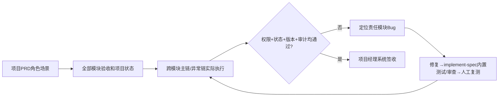

# 项目级端到端业务验收

## 1. 职责和输入

在全部模块人工验收完成后以确认的项目PRD为唯一业务目标，按角色与场景完整执行跨模块业务链、权限和回归，不重复把模块自动测试当成系统业务签收。

- `docs/input/需求资料/（已确认项目PRD与模块PRD）`
- `项目模块实施状态与每轮人工验收`
- `真实可执行的联调环境与必要第三方`

## 2. 执行与验证

1. 按确认PRD的角色×场景列出整个项目可验收矩阵，包括用户授权/项目、需求核对、历史计算单、匹配、成本、业务、多级审批驳回/重提、客户输出与归档、分析审计。
2. 检查真实用户从已有code/前端完成一条报价主链，追踪每个版本的参数、计算依据、审批及归档是否可重现。
3. 按不同角色验证授权边界、数据不可越权访问、重复操作不会双重生成审批或交付记录。
4. 覆盖失败/重试/驳回/取消及已完成模块回归，收集响应、截图、数据库状态、真正第三方接口记录。
5. 项目经理在真实证据基础上逐场景签收；无法使用真实环境的部分标未验收并说明阻塞。

## 3. 审核关卡与失败后回退

所有关键角色场景已有真实执行结果，跨模块主/异常链无阻塞缺陷，项目经理审核同意；否则回到责任模块诊断和复测。

每一项状态必须基于实际文件、真实测试记录、当前代码及环境；没有可执行环境或缺少授权时必须给出阻塞结论，不得编造完成记录。涉及Git提交均使用中文提交说明。

## 4. 正式产物

- `docs/output/07-系统验收/业务场景覆盖矩阵.md`
- `docs/output/07-系统验收/系统验收报告.md`

## 5. 配套材料

- [独立检查门禁](references/execution-gate.md)
- [交付模板](assets/output-template.md)

## 端到端角色业务链的真实判定

把项目PRD中的每个角色×业务场景列成 `场景ID | 角色 | 涉及模块 | 前置数据 | 跨模块操作 | 预期版本/状态 | 真实证据 | 验收人`；主链至少从真实前端入口贯穿权限校验、数据库权威写入和归档输出，异常链覆盖驳回/重提/取消/越权/重复提交。报告放在 `docs/output/07-系统验收/`，项目经理签收的是具体真实场景，不是AI生成的虚拟结论。
