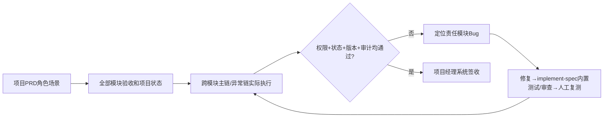

# 项目级端到端业务验收

## 1. 职责和输入

最终全量业务验收在全部模块人工签收后，以项目PRD作为全局目标、模块PRD作为详细行为/权限/异常验收补充，按角色与场景完整执行跨模块业务链、权限和回归，不重复把模块自动测试当成系统业务签收。

- `docs/input/需求资料/（已确认项目PRD与模块PRD）`
- `项目模块实施状态与每轮人工验收`
- `真实可执行的联调环境与必要第三方`
- `开发各轮次增量跨模块契约测试/关键链路联调证据（存在时必读）`

**范围边界**：本 Skill 只做**业务验收**（角色×场景与跨模块业务链）；**非功能验收**（性能、容量、安全等）不在此范围，交发布前专项。

## 2. 执行与验证

1. 联合**当前项目**已确认项目PRD与模块PRD的角色×核心场景生成覆盖矩阵；冲突必须先由项目经理裁定，不得省略模块级异常/权限验收，列出真实存在的页面/模块、主业务操作、跨模块状态和权限边界；Web、IoT、Agent、审批或报表等能力仅在PRD包含时纳入验收。
2. 在真实用户入口执行PRD定义的关键端到端业务链，核对实际业务对象、权威状态、版本/引用及结果是否可重现；没有前端入口的IoT或Agent触发链按实际触发途径验证。
3. 按不同角色验证身份/数据权限、越权拒绝、重复提交的幂等和实际业务终态；不存在的审批/归档功能不增加为强制验收要求。
4. 覆盖失败/重试/驳回/取消；对已完成模块做**回归**（至少覆盖与本次变更共享权威数据、关键状态或权限的场景，不必全量重跑），收集响应、截图、数据库状态、真正第三方接口记录。
5. 项目经理在真实证据基础上逐场景签收；无法使用真实环境的部分标未验收并说明阻塞。

## 3. 审核关卡与失败后回退

所有关键角色场景已有真实执行结果，跨模块主/异常链无阻塞缺陷，项目经理审核同意；否则回到责任模块诊断和复测。

每一项状态必须基于实际文件、真实测试记录、当前代码及环境；没有可执行环境或缺少授权时必须给出阻塞结论，不得编造完成记录。涉及Git提交均使用中文提交说明。

## 4. 正式产物

- `docs/output/07-系统验收/业务场景覆盖矩阵.md`
- `docs/output/07-系统验收/系统验收报告.md`
- `docs/output/07-系统验收/缺陷闭环记录.md`（如有实际缺陷，记录责任模块与复测证据；无缺陷则注明无）

## 5. 配套材料

- [独立检查门禁](references/execution-gate.md)
- [交付模板](assets/output-template.md)：**交付骨架**，与最终报告一一对应。
- [产物清单契约](templates/输出模板.md)：列固定产物、边界与签收口径；**内部契约，不随交付物提交**。

## 端到端角色业务链的真实判定

把当前项目PRD中的每个角色×业务场景列成 `场景ID | 角色 | 涉及模块 | 前置数据 | 跨模块操作 | 预期版本/状态 | 真实证据 | 验收人`；主链沿实际触发入口（已有前端、设备事件、定时任务或Agent）贯穿权限/规则、权威状态与可观察业务输出，异常链只覆盖PRD实际适用的失败/重试、驳回/重提、取消、越权或重复提交。报告放在 `docs/output/07-系统验收/`，项目经理签收的是具体真实场景，不是AI生成的虚拟结论。

### 开发期间的前置增量联调（F18）

本 Skill 的**最终系统级签收**仍在全部模块签收之后。但任何一轮完成“可集成的上游/下游契约”时，就应在开发轮次触发真实或明确标Mock的跨模块契约测试及关键链路联调，并记录 `module_key/任务/构建/合同版本/结果/证据`；不把 Mock 当最终真实验收。S16最终验收读取这些记录并在统一构建上重跑高风险链路和必要全局回归。项目PRD与模块PRD发生冲突须先澄清，不可以“项目PRD唯一”为由舍弃模块已批准细则。