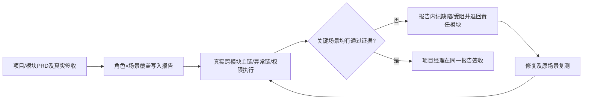

# 系统业务验收：唯一系统验收报告

## 1. 目标、输入与边界

本 Skill 仅对**当前项目实际存在的业务能力**做全项目角色×场景验收及跨模块主链、异常链、权限和变更回归。输入：

- `docs/input/需求资料/`：已确认的**项目PRD及模块PRD**、原型与业务变更记录；
- `docs/output/05-模块拆分/项目模块清单.md`、`docs/output/项目总控/项目实施状态.md`；
- 各任务已有的自动测试、真实人工签收、缺陷和跨模块增量联调证据；
- `code/`、实际可执行的测试环境、角色账号及已授权的第三方/设备接入。

非功能指标（性能、容量、安全基线、备份与恢复目标的专项验收）交给后续**系统验收**阶段的 `release-readiness`，本 Skill 不单独产出专项检查文档。

## 2. 执行步骤

1. 从已确认**项目PRD和模块PRD**抽取角色×核心业务场景、权限、前置状态、异常分支；两级PRD冲突时先请项目经理裁定，不删减模块细则。确认全部相关模块已真实交付，否则在报告内标记未测/受阻。
2. **在系统验收报告正文内**建立场景覆盖表：场景ID、来源、角色、主责/协作模块、入口、前置数据、预期结果、实际执行步骤、实际结果、证据、状态与验收人。不要另生成覆盖矩阵文件。
3. 在真实用户入口（Web、设备事件、第三方回调、定时任务或 Agent，仅限项目实际具有的能力）执行端到端业务主链，核对权威状态、版本/关联、实际操作结果及跨模块可追溯性。
4. 按实际适用性测试角色/租户/项目权限拒绝、重复提交幂等、失败恢复、重试/取消/驳回等异常链，并对受到本轮改动影响的已签收链路做回归；无此业务能力时标不适用。
5. **在同一报告正文内**记录每个缺陷/受阻项的来源场景、责任模块、首次失败证据、修复/解除措施、原场景复测证据和当前状态；不能虚构 Bug 已关闭，也不另生成缺陷闭环记录文件。
6. 汇总实际通过/失败/未测/受阻/不适用数量与阻断项，由项目经理逐场景审核并签署**通过/退回/受阻**结论。缺授权、环境或人工参与时只写待验证/受阻，不声称真实验收成功。

## 3. 放行与回退

- 项目经理审核：角色×场景覆盖、PRD来源、跨模块主/异常链、权限、数据状态、缺陷复测及真实证据。
- 开发人员负责复现、归因、修复与复测；阻断缺陷回到对应模块，走原代码实现/检查/人工测试流程，再回到**同一报告**复核。
- 任一关键场景未测、失败、受阻或缺证据，不能签署全项目业务验收通过；Mock和自动测试不能冒充人工端到端验收。
- 记录构建与环境版本；正式发布版本变更后应评估并重测受影响的业务链。涉及 Git 提交使用中文说明。

## 4. 唯一正式产物

**只生成或更新：**

- `docs/output/07-系统验收/系统验收报告.md`

该报告**内部章节**包含：验收范围与环境、PRD角色×场景覆盖矩阵、主/异常链及权限验证、跨模块联调/回归、缺陷闭环、统计与项目经理签收。既有人工测试单和 Issue 属于输入证据，**不是本 Skill 新增输出**。

禁止新增 `业务场景覆盖矩阵.md` 或 `缺陷闭环记录.md`。

## 5. 配套材料

- [执行检查门禁](references/execution-gate.md)
- [正式报告模板](assets/output-template.md)
- [交付契约模板](templates/输出模板.md)：仅供约束检查，不在项目中另行输出。

> 各轮增量联调可在开发期间执行并作为证据输入；最终统一构建上的业务验收仍需真实复核。不得将示例场景强加到无该业务能力的项目。
